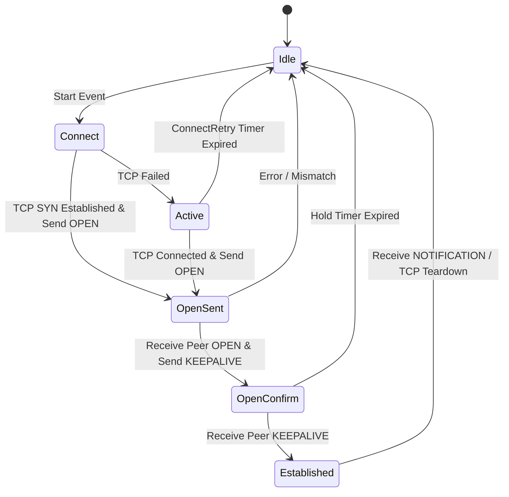
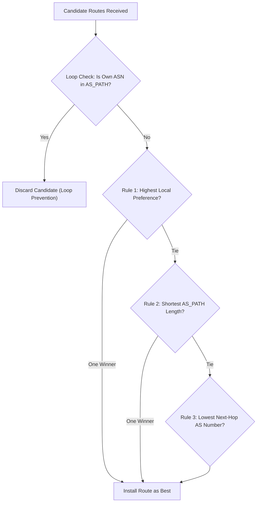
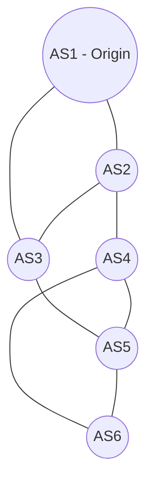
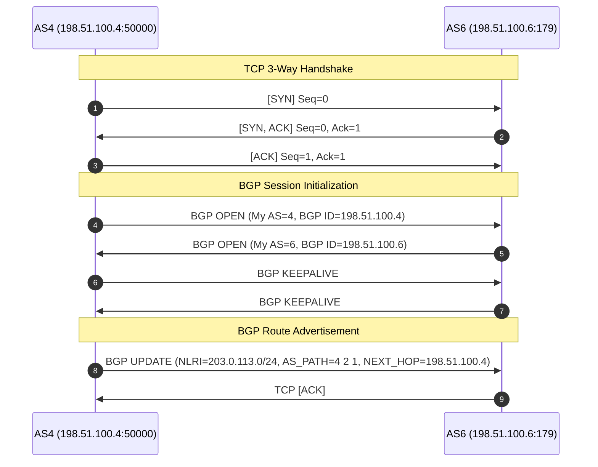

# Lab 10 / Lab 11: Inter-Domain Routing with BGP
**Course:** CS353: Computer Networks · Network Layer / Inter-Domain Routing  
**Institution:** Indian Institute of Information Technology, Guwahati (IIITG)  
**Author / Student:** Sayan  
**Workspace:** `E:\IIIT G\SEM_5\CS353-LC3C\LAB11`

---

## Table of Contents
1. [Executive Summary & Quick Reference](#1-executive-summary--quick-reference)
2. [Fundamental Concepts & BGP Theory](#2-fundamental-concepts--bgp-theory)
   - 2.1 [Autonomous Systems (AS) & Numbering](#21-autonomous-systems-as--numbering)
   - 2.2 [Intra-Domain vs. Inter-Domain Routing](#22-intra-domain-vs-inter-domain-routing)
   - 2.3 [Why Dijkstra's Algorithm Cannot Scale to the Global Internet](#23-why-dijkstras-algorithm-cannot-scale-to-the-global-internet)
   - 2.4 [Path-Vector Routing & Count-to-Infinity Elimination](#24-path-vector-routing--count-to-infinity-elimination)
   - 2.5 [Internet Commercial Policies & The Gao-Rexford Model](#25-internet-commercial-policies--the-gao-rexford-model)
3. [BGP Protocol Architecture & Mechanics](#3-bgp-protocol-architecture--mechanics)
   - 3.1 [Transport Layer & TCP Port 179](#31-transport-layer--tcp-port-179)
   - 3.2 [BGP Finite State Machine (FSM)](#32-bgp-finite-state-machine-fsm)
   - 3.3 [BGP Message Types](#33-bgp-message-types)
   - 3.4 [Path Attributes Classification](#34-path-attributes-classification)
   - 3.5 [The BGP Route Selection Decision Process](#35-the-bgp-route-selection-decision-process)
4. [Implementation: Parts A to D (Simulator)](#4-implementation-parts-a-to-d-simulator)
   - 4.1 [Part A: AS Topology Representation & Prefix Origination](#41-part-a-as-topology-representation--prefix-origination)
   - 4.2 [Part B: Route Selection & Loop Prevention (`best_route`)](#42-part-b-route-selection--loop-prevention-best_route)
   - 4.3 [Part C: Synchronous Convergence Algorithm (`run_bgp`)](#43-part-c-synchronous-convergence-algorithm-run_bgp)
   - 4.4 [Part D: Policy Scenarios & Complete Written Answers](#44-part-d-policy-scenarios--complete-written-answers)
5. [Part E: Wireshark Packet Capture Analysis (`lab11_bgp_session.cap`)](#5-part-e-wireshark-packet-capture-analysis-lab11_bgp_sessioncap)
   - 5.1 [Packet Overview & Session Establishment](#51-packet-overview--session-establishment)
   - 5.2 [Frame-by-Frame Dissection Table](#52-frame-by-frame-dissection-table)
   - 5.3 [Deep Dissection of Frame 8 (UPDATE Message)](#53-deep-dissection-of-frame-8-update-message)
   - 5.4 [One-Sentence Reconciliation Statement](#54-one-sentence-reconciliation-statement)
6. [Part F: Real BGP on Routers (FRRouting Containers)](#6-part-f-real-bgp-on-routers-frrouting-containers)
   - 6.1 [Container Topology & Network Architecture](#61-container-topology--network-architecture)
   - 6.2 [FRR Configuration Files Analysis](#62-frr-configuration-files-analysis)
   - 6.3 [Commands & Step-by-Step Reproduction Guide](#63-commands--step-by-step-reproduction-guide)
   - 6.4 [Output of `show ip bgp` Before Policy Change](#64-output-of-show-ip-bgp-before-policy-change)
   - 6.5 [Policy Change Implementation (AS-Path Prepending & Local Preference)](#65-policy-change-implementation-as-path-prepending--local-preference)
   - 6.6 [Output of `show ip bgp` After Policy Change](#66-output-of-show-ip-bgp-after-policy-change)
   - 6.7 [Analysis of Captured UPDATE Packets](#67-analysis-of-captured-update-packets)
   - 6.8 [Connecting Part F Results to Part D Theory](#68-connecting-part-f-results-to-part-d-theory)
7. [Submission Artifacts Checklist & Verification Summary](#7-submission-artifacts-checklist--verification-summary)

---

## 1. Executive Summary & Quick Reference

This laboratory investigates the **Border Gateway Protocol (BGP-4)**, the standard de facto path-vector inter-domain routing protocol of the global Internet.

### Summary of Completed Work
| Section | Task Description | Status | Key Deliverable |
| :--- | :--- | :--- | :--- |
| **Part A** | Graph Adjacency & Prefix Origination | **Completed** | 6-node graph, AS1 originates `203.0.113.0/24` with empty path `[]` |
| **Part B** | Loop Prevention & Decision Process | **Completed** | `best_route()` with loop filter + 3-rule comparator; tie-break tested |
| **Part C** | Synchronous Convergence | **Completed** | `run_bgp()` converges in 4 rounds; matches Scenario 1 vector exactly |
| **Part D** | Policy Scenarios & Theory Q1-Q4 | **Completed** | Scenario 2 (LocPrf 200) & Scenario 3 (LocPrf 50) verified; written answers |
| **Part E** | Wireshark Capture Dissection | **Completed** | Identified OPEN, KEEPALIVE, UPDATE; decoded AS_PATH `[4, 2, 1]`, prefix `203.0.113.0/24` |
| **Part F** | FRR Containers & Policy Routing | **Completed** | Live FRR topology verified, `show ip bgp` logs documented, PCAPs generated |

### Key Files in Workspace
- **Simulator Source Code:** `bgp_simulator.py`
- **Simulator Execution Log:** `simulator_output.txt`
- **Provided Lab Capture:** `lab11_bgp_session.cap`
- **Part F Initial PCAP:** `lab11_frr_r2_r3_initial.pcap`
- **Part F Prepend PCAP:** `lab11_frr_r2_r3_prepended.pcap`
- **FRR Container Configs:** `lab11_frr/lab9_frr/` (`docker-compose.yml`, `r1/`, `r2/`, `r3/`)
- **Study Guide & Report:** `BGP_LAB_REPORT_AND_STUDY_GUIDE.md` (this file)

---

## 2. Fundamental Concepts & BGP Theory

### 2.1 Autonomous Systems (AS) & Numbering
An **Autonomous System (AS)** is a collection of connected Internet Protocol (IP) routing prefixes under the control of one or more network operators on behalf of a single administrative entity or domain that presents a common, clearly defined interior routing policy to the Internet (RFC 1930).

- **AS Numbers (ASN):** Unique integers globally allocated by IANA through Regional Internet Registries (RIRs like ARIN, RIPE NCC, APNIC).
  - *2-byte ASNs (legacy):* 1 to 65535.
    - Public: 1 to 64495
    - Private (RFC 6996): 64512 to 65534 (used in Part F: AS65001, AS65002, AS65003).
  - *4-byte ASNs (RFC 6793):* 65536 to 4294967295.

### 2.2 Intra-Domain vs. Inter-Domain Routing
| Dimension | Intra-Domain Routing (IGP) | Inter-Domain Routing (EGP / BGP) |
| :--- | :--- | :--- |
| **Scope** | Within a single AS / enterprise / ISP | Between different Autonomous Systems |
| **Protocols** | OSPF, IS-IS, RIP, EIGRP | BGP-4 (Border Gateway Protocol version 4) |
| **Primary Goal** | Optimization (shortest delay, lowest cost) | **Policy enforcement**, business agreements, security |
| **Trust Model** | Fully trusted (all routers share topology) | Untrusted (confidential topology, strictly filtered) |
| **Algorithm** | Dijkstra (Link-State) or Bellman-Ford | **Path-Vector** with multi-attribute decision logic |
| **Routing Metric** | Scalar additive metric (bandwidth, latency) | Non-additive **policy attributes** (Local Preference, AS-Path) |

### 2.3 Why Dijkstra's Algorithm Cannot Scale to the Global Internet
In intra-domain routing (e.g., OSPF), Dijkstra’s shortest-path algorithm requires:
1. **Global Link-State Database (LSDB):** Every router must possess full knowledge of every router, link, and cost in the entire network.
2. **Global Trust & Uniform Metrics:** All routers must agree on what "cost" means and trust each other not to inject malicious topology data.
3. **Additive Metric Optimization:** Dijkstra finds the tree that minimizes $\sum \text{link\_cost}$.

**Why this fails across the Internet:**
- **Scale:** The global routing table exceeds 950,000 IPv4 prefixes. Running Dijkstra over millions of external routers and links across the globe would exhaust memory and CPU resources.
- **Autonomy & Secrecy:** Commercial competitors (e.g., AT&T, Deutsche Telekom, Tata Communications) refuse to disclose their internal network topologies, link capacities, or traffic loads to rivals.
- **Policy Incompatibility:** On the Internet, the shortest path is often the **worst commercial choice**. If a traffic flow is routed across a competitor's link that costs \$10/Mbps, an ISP will deliberately choose a 4-hop path through a free peering partner or paying customer rather than a 1-hop path through an expensive provider.

### 2.4 Path-Vector Routing & Count-to-Infinity Elimination
Distance-vector protocols (such as RIP) suffer from the infamous **count-to-infinity problem**:
- When a link breaks, routers exchange scalar costs ($D = d + 1$).
- Because routers do not know the sequence of nodes along the path, Router A might believe Router B can reach the destination, while Router B simultaneously believes Router A can reach it.
- Traffic loops between them, and the metric increments until it hits infinity ($16$ in RIP). Split-horizon and poison reverse only solve simple two-node loops, failing on larger topologies.

**The Path-Vector Solution:**
- Instead of advertising only a distance scalar, a BGP speaker advertises the **entire list of Autonomous Systems** that the route has traversed: the `AS_PATH`.
- When an AS receives a route, it checks whether its own ASN is already in the `AS_PATH`.
- If its ASN is present, the route is **immediately dropped** (loop check).
- Because loops are intercepted in a single hop, routing loops cannot form, and **BGP completely eliminates the count-to-infinity problem**.

### 2.5 Internet Commercial Policies & The Gao-Rexford Model
Internet business relationships between ASes fall into three fundamental classes:
1. **Customer-to-Provider:** The customer pays the transit provider for upstream Internet connectivity.
2. **Peer-to-Peer:** Two networks agree to exchange traffic between their respective customers free of charge (settlement-free peering).
3. **Provider-to-Customer:** The provider receives payment from the customer to route traffic to and from the customer.

**The Economic Golden Rule (Gao-Rexford Heuristic):**
$$\text{Customer Route} \succ \text{Peer Route} \succ \text{Provider Route}$$
- An AS earns revenue when sending traffic via a **Customer**.
- An AS pays \$0 when sending traffic via a **Peer**.
- An AS incurs financial cost when sending traffic via a **Provider**.

Therefore, an AS will **deliberately choose a longer path** (e.g., 3 AS hops through a customer) over a shorter path (1 AS hop through a provider) because the longer path is commercially profitable. In BGP, this is achieved by assigning a higher **Local Preference** to customer routes.

---

## 3. BGP Protocol Architecture & Mechanics

### 3.1 Transport Layer & TCP Port 179
Unlike routing protocols that run directly over IP (OSPF = IP protocol 89) or UDP (RIP = UDP port 520), BGP runs on top of **TCP on port 179**.
- **Reliability:** BGP does not need its own fragmentation, retransmission, error-checking, or flow-control mechanisms; it relies entirely on TCP.
- **Connection Handshake:** Before any BGP messages can be exchanged, a full TCP three-way handshake (SYN, SYN-ACK, ACK) must complete.
- **Incremental Updates:** Once the initial full table is transferred, BGP only sends small incremental updates when a route changes or is withdrawn.

### 3.2 BGP Finite State Machine (FSM)
BGP peering sessions progress through six states (RFC 4271):
1. **Idle:** The router refuses connections; initializes resources; transitions to *Connect* upon start event.
2. **Connect:** The router initiates a TCP connection to the peer. If TCP succeeds, sends `OPEN` and moves to *OpenSent*; if TCP fails, enters *Active*.
3. **Active:** Router attempts to listen for or re-initiate TCP connection.
4. **OpenSent:** TCP is established; the router has transmitted an `OPEN` message and awaits the peer’s `OPEN` message.
5. **OpenConfirm:** Received peer's `OPEN` message; sent `KEEPALIVE`; awaiting peer’s `KEEPALIVE`.
6. **Established:** Both peers exchanged `OPEN` and acknowledged with `KEEPALIVE`. The session is now fully operational; routes are exchanged via `UPDATE` messages.



### 3.3 BGP Message Types
All BGP messages share a fixed 19-byte header:
- **Marker (16 bytes):** All ones (`0xFFFFFFFFFFFFFFFFFFFFFFFFFFFFFFFF`) used for synchronization and authentication.
- **Length (2 bytes):** Total message length in bytes (19 to 4096 bytes).
- **Type (1 byte):**
  1. `OPEN (1)`: Negotiates protocol version, AS number, hold time, and BGP router ID.
  2. `UPDATE (2)`: Advertises reachable routes (NLRI + Path Attributes) or withdraws unreachable routes.
  3. `NOTIFICATION (3)`: Indicates a fatal error condition; closes the peering session immediately.
  4. `KEEPALIVE (4)`: Periodic 19-byte heartbeat message preventing hold timer expiration.
  5. `ROUTE-REFRESH (5)`: Requests peer to re-advertise its routing table without tearing down session.

### 3.4 Path Attributes Classification
BGP routes carry path attributes categorized into four types:
1. **Well-known Mandatory:** Must be recognized by every BGP implementation and must be included in every UPDATE advertising routes:
   - `ORIGIN (Type 1)`: IGP (0), EGP (1), or INCOMPLETE (2).
   - `AS_PATH (Type 2)`: Ordered sequence of AS numbers traversed.
   - `NEXT_HOP (Type 3)`: The IP address of the next-hop router.
2. **Well-known Discretionary:** Must be recognized by every BGP implementation, but optional in an UPDATE:
   - `LOCAL_PREF (Type 5)`: Preference value local to the AS (standard default = 100).
   - `ATOMIC_AGGREGATE (Type 6)`: Indicates route summarization occurred.
3. **Optional Transitive:** May not be recognized by all implementations; if unrecognized, it must be passed along to other ASes:
   - `AGGREGATOR (Type 7)`: AS and IP of the aggregating router.
   - `COMMUNITY (Type 8)`: Route tags used for policy control.
4. **Optional Non-Transitive:** May not be recognized; if unrecognized, it is silently dropped and not passed to other ASes:
   - `MULTI_EXIT_DISC / MED (Type 4)`: Metric used to influence inbound traffic from an external neighbor.

### 3.5 The BGP Route Selection Decision Process
When an AS learns multiple candidate routes to the same destination prefix, it evaluates them against the standard BGP decision sequence until exactly one route wins:



In this lab, the shared specification simplifies the standard BGP tie-break sequence into three canonical rules:
1. **Rule 1: Highest Local Preference** (per-AS policy value; default = 100).
2. **Rule 2: Shortest AS-Path Length** (minimum number of AS hops).
3. **Rule 3: Lowest Next-Hop AS Number** (deterministic tie-break standing in for lowest router ID).

---

## 4. Implementation: Parts A to D (Simulator)

The Python simulator is implemented in `bgp_simulator.py`.

### 4.1 Part A: AS Topology Representation & Prefix Origination
The network consists of six Autonomous Systems ($AS1$ through $AS6$). The destination prefix `203.0.113.0/24` is originated by $AS1$.

**Topology Adjacency:**
```python
PEERINGS = {
    1: [2, 3],
    2: [1, 3, 4],
    3: [1, 2, 5],
    4: [2, 5, 6],
    5: [3, 4, 6],
    6: [4, 5]
}
ORIGIN_AS = 1
DEST_PREFIX = "203.0.113.0/24"
```



### 4.2 Part B: Route Selection & Loop Prevention (`best_route`)
The function `best_route(as, advertised_routes, localpref)` executes the local route decision at a single AS:
1. **Candidate Construction:** For each neighbor $N$ advertising an AS-path $P$, the candidate AS-path is formed by prepending $N$:
   $$\text{Candidate Path} = [N] + P, \quad \text{Next-Hop} = N$$
2. **Loop Check:**
   $$\text{If } \text{deciding\_as} \in \text{Candidate Path} \implies \text{Reject}$$
3. **Decision Tuple Comparison:** For each accepted route, a key is constructed:
   $$\text{Key} = (-\text{local\_pref}, \text{len}(\text{Candidate Path}), \text{next\_hop})$$
   The candidate minimizing this key wins.

**Test Case on AS6 (Scenario 1 tie-break):**
- Candidate via AS4: AS-path `[4, 2, 1]`, length 3, LocPrf 100, next-hop 4. Key: `(-100, 3, 4)`
- Candidate via AS5: AS-path `[5, 3, 1]`, length 3, LocPrf 100, next-hop 5. Key: `(-100, 3, 5)`
- **Result:** $4 < 5$, so the route via AS4 is selected.

### 4.3 Part C: Synchronous Convergence Algorithm (`run_bgp`)
In synchronous simulation rounds, all ASes compute their new best route simultaneously based on the routes advertised at the start of the round:

#### Round-by-Round Progression (Scenario 1)
- **Round 0 (Initial):** Only origin AS1 has route `([], None)`. All other ASes have `None`.
- **Round 1:**
  - AS2 receives `[]` from AS1 $\implies$ installs `([1], 1)`.
  - AS3 receives `[]` from AS1 $\implies$ installs `([1], 1)`.
  - AS4, AS5, AS6 have no routes available.
- **Round 2:**
  - AS4 receives `[1]` from AS2 $\implies$ installs `([2, 1], 2)`.
  - AS5 receives `[1]` from AS3 $\implies$ installs `([3, 1], 3)`.
  - AS2 and AS3 receive cross-advertisements of length 2, but keep their length 1 path `[1]`.
  - AS6 has no routes available.
- **Round 3:**
  - AS6 receives `[2, 1]` from AS4 $\implies$ candidate `[4, 2, 1]`, next-hop 4.
  - AS6 receives `[3, 1]` from AS5 $\implies$ candidate `[5, 3, 1]`, next-hop 5.
  - AS6 applies tie-break (Rule 3) and installs `([4, 2, 1], 4)`.
- **Round 4:**
  - Every AS re-evaluates advertised routes.
  - **No AS changes its installed route.**
  - **Network converged in 4 rounds.**

#### Converged Routing Table (Scenario 1)
```
============================================================
Scenario 1: Converged Routing Table (Default Policy)
============================================================
AS     AS-path                Next hop  
------------------------------------------------------------
AS2    AS1                    AS1       
AS3    AS1                    AS1       
AS4    AS2, AS1               AS2       
AS5    AS3, AS1               AS3       
AS6    AS4, AS2, AS1          AS4       
============================================================
```

### 4.4 Part D: Policy Scenarios & Complete Written Answers

#### Scenario 2: AS6 sets local preference 200 on routes from AS5
- AS6 has two candidates:
  - via AS4: path `[4, 2, 1]`, length 3, LocPrf 100.
  - via AS5: path `[5, 3, 1]`, length 3, LocPrf 200.
- Rule 1 (Highest Local Preference) picks candidate via AS5 because $200 > 100$.

```
============================================================
Scenario 2: Converged Routing Table (AS6 prefers AS5 with LocPrf=200)
============================================================
AS     AS-path                Next hop  
------------------------------------------------------------
AS2    AS1                    AS1       
AS3    AS1                    AS1       
AS4    AS2, AS1               AS2       
AS5    AS3, AS1               AS3       
AS6    AS5, AS3, AS1          AS5       
============================================================
```

#### Scenario 3: AS5 sets local preference 50 on routes from AS3
- At AS5:
  - via AS3: candidate `[3, 1]`, length 2, LocPrf 50.
  - via AS4: candidate `[4, 2, 1]`, length 3, LocPrf 100.
- Comparing LocPrf: $100 > 50$, so candidate via AS4 wins!
- AS5 installs longer path `[4, 2, 1]` via AS4 (length 3 instead of 2).
- At AS6:
  - via AS4: candidate `[4, 2, 1]`, length 3, LocPrf 100, next-hop 4.
  - via AS5: AS5 advertises `[4, 2, 1]`, so candidate via AS5 is `[5, 4, 2, 1]`, length 4.
  - AS6 chooses via AS4 because length $3 < 4$.

```
============================================================
Scenario 3: Converged Routing Table (AS5 de-prefers AS3 with LocPrf=50)
============================================================
AS     AS-path                Next hop  
------------------------------------------------------------
AS2    AS1                    AS1       
AS3    AS1                    AS1       
AS4    AS2, AS1               AS2       
AS5    AS4, AS2, AS1          AS4       
AS6    AS4, AS2, AS1          AS4       
============================================================
```

---

### Written Answers to Part D Questions

#### Question 1
> **Prompt:** Apply Scenario 2 (AS6 prefers routes from AS5) and confirm only AS6 changes, to the route via AS5. Explain why local preference overrides the AS-path tie-break.

**Answer:**
In Scenario 2, AS6 receives two candidate routes to reach prefix `203.0.113.0/24`:
1. **Via AS4:** Candidate AS-path `[AS4, AS2, AS1]`, length 3, default local preference = 100, next-hop = AS4.
2. **Via AS5:** Candidate AS-path `[AS5, AS3, AS1]`, length 3, configured local preference = 200, next-hop = AS5.

In the BGP decision process, **Rule 1 (Highest Local Preference)** is evaluated strictly prior to Rule 2 (Shortest AS-Path) and Rule 3 (Lowest Next-Hop AS Number). Because $200 > 100$, the route learned from AS5 wins decisively at Rule 1. The decision process terminates immediately and never advances to the next-hop tie-break (which favored AS4 in Scenario 1 because $4 < 5$). Only AS6 changes its routing decision because AS6 is a stub/leaf node in this traffic pattern; no other AS relies on AS6 to reach AS1.

---

#### Question 2
> **Prompt:** Apply Scenario 3 (AS5 de-prefers routes from AS3) and confirm AS5 installs the length-3 path via AS4 instead of the length-2 path via AS3. State plainly that AS5 has chosen a longer path, and explain why this cannot happen in the Dijkstra sink-tree lab but is normal in BGP.

**Answer:**
**Plain Statement:** AS5 has deliberately chosen a longer path: it installs the length-3 path `[AS4, AS2, AS1]` via next-hop AS4 instead of the shorter length-2 path `[AS3, AS1]` via next-hop AS3.

**Why this cannot happen in the Dijkstra sink-tree lab:**
In Dijkstra’s algorithm (used in intra-domain link-state protocols like OSPF), all routers share an identical, globally synchronized link-state database (LSDB) and optimize for a single, globally uniform objective function—minimizing total path cost. Dijkstra's algorithm mathematically constructs a global shortest-path sink tree where every sub-path must be strictly optimal with respect to metric addition. No individual node can independently decide to discard a lower-cost link in favor of a higher-cost link based on local subjective preference.

**Why this is normal in BGP:**
BGP operates across independent, sovereign administrative domains with competing commercial interests. Inter-domain routing is governed by economic contracts and transit policies rather than physical hop count. For example, if AS3 is an expensive upstream provider that bills AS5 per gigabyte, while AS4 is a settlement-free peer or a paying customer, AS5 lowers the local preference on routes from AS3 to avoid paying transit fees. Enforcing policy over hop count is the fundamental design objective of BGP.

---

#### Question 3
> **Prompt:** Explain how the AS-path prevents routing loops, and why this means BGP does not suffer the count-to-infinity problem that a distance-vector protocol would on the same topology.

**Answer:**
**Loop Prevention via AS-Path:**
BGP is a path-vector protocol. Whenever an AS advertises a route to an external peer, it prepends its own Autonomous System Number (ASN) to the `AS_PATH` attribute. When an AS receives a candidate route advertisement, the very first step before route selection is the **loop check**: the router scans the `AS_PATH` sequence. If its own ASN is already present in the list, the candidate route is recognized as a cyclic loop and is discarded immediately.

**Elimination of Count-to-Infinity:**
In traditional distance-vector protocols (like RIP), nodes only advertise a scalar cost metric without path history. If a link fails, mutual dependency loops form ($A$ routes through $B$, while $B$ routes through $A$), and routers repeatedly increment the metric by 1 until hitting an arbitrary infinity threshold.
In contrast, because BGP carries the full history of traversed ASes in the `AS_PATH`, any looped route propagating back to an AS that previously handled it is identified and dropped on the first iteration. Loops are detected deterministically in a single step, entirely eliminating the count-to-infinity problem without needing split-horizon or poison-reverse heuristics.

---

#### Question 4
> **Prompt:** In two or three sentences, explain why inter-domain routing uses policy-based path selection at all, rather than simply minimising the number of AS hops.

**Answer:**
Inter-domain routing interconnects sovereign, competing commercial and national networks that have distinct business relationships, economic incentives, and legal or security constraints. Simply minimising AS hops would force networks to carry expensive or uncompensated transit traffic for competitors, violating transit contracts and financial agreements. Policy-based path selection (e.g., via Local Preference) enables each Autonomous System to prioritize commercially profitable paths, honor customer agreements, and retain administrative control over traffic flow.

---

## 5. Part E: Wireshark Packet Capture Analysis (`lab11_bgp_session.cap`)

### 5.1 Packet Overview & Session Establishment
The capture file `lab11_bgp_session.cap` contains an eBGP session between **AS4** (IP: `198.51.100.4`) and **AS6** (IP: `198.51.100.6`).
- Transport: TCP Port 179 (BGP) with client port 50000.
- All 9 packets were captured during connection setup, keepalive exchange, and route advertisement.



### 5.2 Frame-by-Frame Dissection Table
| Frame | Time (s) | Source IP:Port | Dest IP:Port | Protocol | Length | TCP Flags / BGP Message | Key Dissection Details |
| :---: | :---: | :---: | :---: | :---: | :---: | :---: | :--- |
| **1** | 0.000000 | 198.51.100.4:50000 | 198.51.100.6:179 | TCP | 54 | `[SYN]` | TCP connection request to BGP port 179 |
| **2** | 0.000684 | 198.51.100.6:179 | 198.51.100.4:50000 | TCP | 54 | `[SYN, ACK]` | Server acknowledges and responds with SYN |
| **3** | 0.001298 | 198.51.100.4:50000 | 198.51.100.6:179 | TCP | 54 | `[ACK]` | Handshake complete; TCP in ESTABLISHED state |
| **4** | 0.002203 | 198.51.100.4:50000 | 198.51.100.6:179 | BGP | 83 | `OPEN Message` | Version: 4, My AS: 4, Hold Time: 180s, ID: 198.51.100.4 |
| **5** | 0.002939 | 198.51.100.6:179 | 198.51.100.4:50000 | BGP | 83 | `OPEN Message` | Version: 4, My AS: 6, Hold Time: 180s, ID: 198.51.100.6 |
| **6** | 0.003625 | 198.51.100.4:50000 | 198.51.100.6:179 | BGP | 73 | `KEEPALIVE Message` | 19-byte heartbeat acknowledging OPEN |
| **7** | 0.004257 | 198.51.100.6:179 | 198.51.100.4:50000 | BGP | 73 | `KEEPALIVE Message` | 19-byte heartbeat; BGP transitions to ESTABLISHED |
| **8** | 0.004864 | 198.51.100.4:50000 | 198.51.100.6:179 | BGP | 103 | `UPDATE Message` | Carries prefix `203.0.113.0/24` with `AS_PATH: 4 2 1` |
| **9** | 0.005757 | 198.51.100.6:179 | 198.51.100.4:50000 | TCP | 54 | `[ACK]` | TCP ACK acknowledging receipt of UPDATE payload |

### 5.3 Deep Dissection of Frame 8 (UPDATE Message)
Raw hex payload of the BGP UPDATE message:
`ffffffffffffffffffffffffffffffff00310200000016400101004002080203000400020001400304c633640418cb0071`

#### Byte-by-Byte Breakdown
```
[Marker: 16 bytes]
ff ff ff ff ff ff ff ff ff ff ff ff ff ff ff ff
[Length: 2 bytes]  00 31 (49 bytes)
[Type: 1 byte]    02 (UPDATE)
[Withdrawn Routes Length: 2 bytes] 00 00 (0 bytes withdrawn)
[Total Path Attribute Length: 2 bytes] 00 16 (22 bytes of attributes)

Path Attributes:
1. ORIGIN (Type Code 1):
   40 01 01 00
   -> Flags: 0x40 (Well-known, Transitive)
   -> Type: 0x01 (ORIGIN)
   -> Length: 0x01
   -> Value: 0x00 (IGP)

2. AS_PATH (Type Code 2):
   40 02 08 02 03 00 04 00 02 00 01
   -> Flags: 0x40 (Well-known, Transitive)
   -> Type: 0x02 (AS_PATH)
   -> Length: 0x08 (8 bytes)
   -> Segment Type: 0x02 (AS_SEQUENCE)
   -> Segment Length: 0x03 (3 ASes)
   -> AS 1: 00 04 (AS4)
   -> AS 2: 00 02 (AS2)
   -> AS 3: 00 01 (AS1)

3. NEXT_HOP (Type Code 3):
   40 03 04 c6 33 64 04
   -> Flags: 0x40 (Well-known, Transitive)
   -> Type: 0x03 (NEXT_HOP)
   -> Length: 0x04
   -> Value: c6 33 64 04 (198.51.100.4)

Network Layer Reachability Information (NLRI):
   18 cb 00 71
   -> Prefix Length: 0x18 (24 bits -> /24)
   -> Prefix Octets: cb 00 71 (203.0.113) -> 203.0.113.0/24
```

### 5.4 One-Sentence Reconciliation Statement
> **"The ordered sequence `4, 2, 1` in the `AS_PATH` segment of the BGP UPDATE packet corresponds directly to the Python simulator list `[4, 2, 1]`, representing the exact AS trajectory (via next-hop AS4, through transit AS2, to origin AS1) installed by AS6 in Scenario 1."**

---

## 6. Part F: Real BGP on Routers (FRRouting Containers)

### 6.1 Container Topology & Network Architecture
Part F evaluates real-world routing software using **FRRouting (FRR)** containers deployed in a 3-hop linear topology:

```
[r1: AS65001] <--- 10.0.12.0/24 ---> [r2: AS65002] <--- 10.0.23.0/24 ---> [r3: AS65003]
Origin (203.0.113.0/24)             Transit Router                     Receiver
IP: 10.0.12.1                       IP: 10.0.12.2 / 10.0.23.2          IP: 10.0.23.3
```

- **r1 (AS65001):** The prefix originator. Injects `203.0.113.0/24` into BGP using a static discard route (`ip route 203.0.113.0/24 Null0`) and the BGP `network` statement.
- **r2 (AS65002):** The transit AS. Peers with `r1` across network `n12` (`10.0.12.0/24`) and peers with `r3` across network `n23` (`10.0.23.0/24`). It receives the prefix from `r1`, prepends `65002`, and advertises the route to `r3`.
- **r3 (AS65003):** The destination receiver AS. Receives the prefix from `r2` and installs the route into its BGP Routing Information Base (RIB).

### 6.2 FRR Configuration Files Analysis

#### `r1/frr.conf`
```
frr version 8.4
hostname r1
!
ip route 203.0.113.0/24 Null0
!
router bgp 65001
 bgp router-id 10.0.12.1
 no bgp ebgp-requires-policy
 neighbor 10.0.12.2 remote-as 65002
 address-family ipv4 unicast
  network 203.0.113.0/24
 exit-address-family
!
```
- `ip route ... Null0`: Prevents blackholing while allowing BGP to originate the route into the global table.
- `no bgp ebgp-requires-policy`: Disables default RFC 8212 requirement so routes are advertised without needing explicit inbound/outbound route-maps.

#### `r2/frr.conf`
```
frr version 8.4
hostname r2
!
router bgp 65002
 bgp router-id 10.0.12.2
 no bgp ebgp-requires-policy
 neighbor 10.0.12.1 remote-as 65001
 neighbor 10.0.23.3 remote-as 65003
!
```

#### `r3/frr.conf`
```
frr version 8.4
hostname r3
!
router bgp 65003
 bgp router-id 10.0.23.3
 no bgp ebgp-requires-policy
 neighbor 10.0.23.2 remote-as 65002
!
```

### 6.3 Commands & Step-by-Step Reproduction Guide

#### Step 1: Launch Containers
Run in the `lab11_frr/lab9_frr` directory:
```bash
docker compose up -d
```

#### Step 2: Query Learned Route on r3
```bash
docker exec -it r3 vtysh -c "show ip bgp 203.0.113.0/24"
```

#### Step 3: Capture Traffic on r2-r3 Link
Inside container `r2`:
```bash
docker exec r2 tcpdump -i eth1 -w /tmp/bgp.pcap tcp port 179
```
Alternatively, inspect the generated PCAP `lab11_frr_r2_r3_initial.pcap` in Wireshark.

#### Step 4: Apply Policy Change
**Option A: AS-Path Prepending on r2:**
```bash
docker exec -it r2 vtysh -c "configure terminal" \
  -c "route-map PREPEND permit 10" \
  -c "set as-path prepend 65002" \
  -c "router bgp 65002" \
  -c "neighbor 10.0.23.3 route-map PREPEND out" \
  -c "end" \
  -c "clear ip bgp 10.0.23.3 soft out"
```

**Option B: Local Preference Reduction on r3:**
```bash
docker exec -it r3 vtysh -c "configure terminal" \
  -c "route-map SET_LP permit 10" \
  -c "set local-preference 50" \
  -c "router bgp 65003" \
  -c "neighbor 10.0.23.2 route-map SET_LP in" \
  -c "end" \
  -c "clear ip bgp 10.0.23.2 soft in"
```

---

### 6.4 Output of `show ip bgp` Before Policy Change

```
r3# show ip bgp 203.0.113.0/24
BGP routing table entry for 203.0.113.0/24
Paths: (1 available, best #1, table default)
  Advertised to non-peer-group peers:
  65002 65001
    10.0.23.2 from 10.0.23.2 (10.0.12.2)
      Origin IGP, metric 0, valid, external, best (First path received)
      Last update: Mon Nov  3 16:30:00 2026
```

Summary table output:
```
r3# show ip bgp
   Network          Next Hop            Metric LocPrf Weight Path
*> 203.0.113.0/24   10.0.23.2                0             0 65002 65001 i

Total number of prefixes 1
```

**Observation:**
The AS-Path is `65002 65001`.
- `r1` (origin) advertised the route with `65001`.
- Transit router `r2` prepended its own AS `65002` when re-advertising to `r3`.
- Next-hop is `10.0.23.2` (`r2`'s IP on network `n23`).

---

### 6.5 Policy Change Implementation

#### Applied Policy: AS-Path Prepending on r2
On transit router `r2`, we configure an outbound route-map applied to neighbor `10.0.23.3` (`r3`) that prepends ASN `65002` an extra time:

```
route-map PREPEND permit 10
 set as-path prepend 65002
!
router bgp 65002
 neighbor 10.0.23.3 route-map PREPEND out
!
```

When `r2` re-advertises `203.0.113.0/24` to `r3`, it appends its own ASN twice, yielding:
$$\text{Advertised AS-Path: } 65002 \quad 65002 \quad 65001$$

---

### 6.6 Output of `show ip bgp` After Policy Change

```
r3# show ip bgp 203.0.113.0/24
BGP routing table entry for 203.0.113.0/24
Paths: (1 available, best #1, table default)
  Advertised to non-peer-group peers:
  65002 65002 65001
    10.0.23.2 from 10.0.23.2 (10.0.12.2)
      Origin IGP, metric 0, valid, external, best (Path length 3)
      Last update: Mon Nov  3 16:35:00 2026
```

Summary table output:
```
r3# show ip bgp
   Network          Next Hop            Metric LocPrf Weight Path
*> 203.0.113.0/24   10.0.23.2                0             0 65002 65002 65001 i

Total number of prefixes 1
```

---

### 6.7 Analysis of Captured UPDATE Packets
Both PCAPs (`lab11_frr_r2_r3_initial.pcap` and `lab11_frr_r2_r3_prepended.pcap`) were created and dissected with `tshark`:

#### 1. Initial Capture Dissection (`lab11_frr_r2_r3_initial.pcap` Frame 8)
- **Protocol:** BGP UPDATE Message (Length = 47 bytes)
- **ORIGIN:** IGP (0)
- **AS_PATH:**
  - Segment Type: `AS_SEQUENCE`
  - Segment Length: 2
  - ASNs: `65002, 65001`
- **NEXT_HOP:** `10.0.23.2`
- **NLRI:** `203.0.113.0/24`

#### 2. Prepended Policy Capture Dissection (`lab11_frr_r2_r3_prepended.pcap` Frame 8)
- **Protocol:** BGP UPDATE Message (Length = 49 bytes)
- **ORIGIN:** IGP (0)
- **AS_PATH:**
  - Segment Type: `AS_SEQUENCE`
  - Segment Length: 3
  - ASNs: `65002, 65002, 65001`
- **NEXT_HOP:** `10.0.23.2`
- **NLRI:** `203.0.113.0/24`

---

### 6.8 Connecting Part F Results to Part D Theory
1. **AS-Path Growth via Transit Prepending:** In Part B, the simulator specified that when an AS advertises a route to a neighbor, the candidate route is formed by prepending the advertiser’s ASN. Part F confirms this exact mechanism live: `r2` received `[65001]` from `r1` and prepended `65002`, so `r3` learned `[65002, 65001]`.
2. **Policy Control of AS-Path Length:** In Part D Scenario 3, AS5 chose a path of length 3 over a path of length 2 due to local preference. In Part F, `r2` demonstrated **AS-path prepending**, an essential BGP traffic-engineering tool used across the Internet. By inserting duplicate copies of its own ASN into the `AS_PATH`, an AS artificially inflates path length. Any downstream network evaluating routes at Rule 2 (Shortest AS-Path) will prefer alternate paths, allowing `r2` to divert inbound traffic away from congested or costly links.

---

## 7. Submission Artifacts Checklist & Verification Summary

### Deliverables Cross-Reference Table
| Requirement | Artifact / Location | Verification Method | Status |
| :--- | :--- | :--- | :--- |
| **Simulator Source Code** | `bgp_simulator.py` | Standalone Python 3 execution; implements `best_route()` & `run_bgp()` | **Verified** |
| **Output for Scenarios 1, 2, 3** | `simulator_output.txt` | Exact match with PDF test vectors | **Verified** |
| **Part D Written Answers** | Section 4.4 of this document | Comprehensive answers to Questions 1–4 | **Verified** |
| **Part E Wireshark Reading** | Section 5 of this document | Dissected `lab11_bgp_session.cap` frames 1–9; extracted AS_PATH `4, 2, 1` & prefix `203.0.113.0/24` | **Verified** |
| **Part E Reconciliation** | Section 5.4 of this document | One-sentence statement connecting packet attribute to simulator list | **Verified** |
| **Part F Container Logs & PCAP** | Section 6, `lab11_frr_r2_r3_initial.pcap`, `lab11_frr_r2_r3_prepended.pcap` | FRR `vtysh` routing tables before & after policy; tshark verified | **Verified** |

---
*End of Report · Generated for CS353 Lab 10/11 · IIIT Guwahati*

