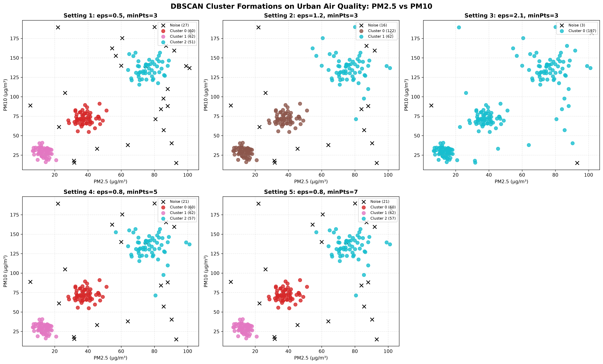

# Machine Learning Laboratory — Evaluation Assignment 3 (EA3)
# Lab Report & Comprehensive Study Guide

**Course:** CS 306 / CS360 — Machine Learning Laboratory  
**Department:** Computer Science & Engineering, Indian Institute of Information Technology Guwahati (IIITG)  
**Evaluation:** Evaluation Assignment 3 (EA3)  
**Student Roll Number:** 2401179  
**Topic:** Unsupervised Density-Based Spatial Clustering of Applications with Noise (DBSCAN), Urban Air Quality Monitoring, Outlier and Hotspot Detection, Feature Standardization, Parameter Sensitivity ($\varepsilon, \text{minPts}$), and Silhouette Coefficient Validity

---

## 1. Executive Summary & Experimental Objectives

Evaluation Assignment 3 explores non-parametric density-based clustering using **DBSCAN (Density-Based Spatial Clustering of Applications with Noise)** to group urban air quality monitoring stations exhibiting homogeneous pollution signatures and isolate abnormal pollution spikes (outliers/noise). The data consists of $N = 200$ monitoring station observations measuring four continuous atmospheric pollutants:
1. $\text{PM}_{2.5}$: Fine particulate matter with diameter $\le 2.5\,\mu\text{m}$ ($\mu\text{g}/\text{m}^3$)
2. $\text{PM}_{10}$: Coarse particulate matter with diameter $\le 10\,\mu\text{m}$ ($\mu\text{g}/\text{m}^3$)
3. $\text{NO}_2$: Nitrogen dioxide gaseous concentration ($\mu\text{g}/\text{m}^3$)
4. $\text{SO}_2$: Sulphur dioxide gaseous concentration ($\mu\text{g}/\text{m}^3$)

The experimental milestones include:
1. **Data Ingestion & Attribute Extraction:** Parsing `synthetic_urban_air_quality.csv` and isolating the four numeric pollutant concentration features.
2. **Z-Score Feature Standardization:** Rescaling all features to zero mean ($\mu = 0$) and unit variance ($\sigma = 1$), eliminating baseline scale distortion across particulate vs gaseous pollutants.
3. **Parametric Sensitivity Exploration across Five Configurations:**
   - Setting 1: $\varepsilon = 0.5, \text{minPts} = 3$
   - Setting 2: $\varepsilon = 1.2, \text{minPts} = 3$
   - Setting 3: $\varepsilon = 2.1, \text{minPts} = 3$
   - Setting 4: $\varepsilon = 0.8, \text{minPts} = 5$
   - Setting 5: $\varepsilon = 0.8, \text{minPts} = 7$
4. **Noise Point and Anomaly Identification:** Tracking the exact count and percentage of points rejected as noise across each parameter setting.
5. **Cluster Visual Profiling:** Constructing high-resolution 2D scatter plots of $\text{PM}_{2.5}$ vs $\text{PM}_{10}$ color-coded by cluster membership with noise points clearly highlighted.
6. **Silhouette Coefficient Computation & Theoretical Preconditions:** Evaluating cluster cohesion and separation using the Silhouette score, rigorously verifying assignment constraints ($K \ge 2$, $K < N_{\text{valid}}$, and no singletons) after filtering noise points.
7. **Noise Point Treatment in Cluster Validation:** Providing formal theoretical justifications for why noise points cannot be assigned a valid silhouette score.

---

## 2. Theoretical Foundations & Mathematical Formulations

### 2.1 The Geometry of Density-Based Clustering (DBSCAN)

Unlike partition-based clustering algorithms like $K$-Means (which assume spherical clusters of similar size and assign every point to a cluster), DBSCAN identifies clusters as **continuous regions of high point density separated by regions of low density**, and naturally handles clusters of arbitrary geometric shape while isolating noise points.

Let the feature space be endowed with Euclidean metric $d(\mathbf{x}_i, \mathbf{x}_j) = \|\mathbf{x}_i - \mathbf{x}_j\|_2$. Two hyperparameters govern the definition of density:
1. **Epsilon ($\varepsilon > 0$):** The radius defining the local neighborhood of a point.
2. **MinPts ($\text{minPts} \in \mathbb{N}_{\ge 1}$):** The minimum number of points required within the $\varepsilon$-neighborhood to form a dense region.

```
                  ┌────────────────────────────────────────┐
                  │ Point Types in Density-Based Space     │
                  └───────────────────┬────────────────────┘
                                      │
         ┌────────────────────────────┼────────────────────────────┐
         ▼                            ▼                            ▼
┌──────────────────┐         ┌──────────────────┐         ┌──────────────────┐
│    Core Point    │         │   Border Point   │         │    Noise Point   │
│ |N_ε(p)| ≥ minPts│         │|N_ε(p)| < minPts,│         │|N_ε(p)| < minPts,│
│ Starts cluster   │         │but in N_ε of Core│         │ not near any core│
└──────────────────┘         └──────────────────┘         └──────────────────┘
```

#### Formal Definitions:
1. **$\varepsilon$-Neighborhood:**
   $$N_{\varepsilon}(\mathbf{p}) = \{ \mathbf{q} \in \mathcal{D} \mid \|\mathbf{p} - \mathbf{q}\|_2 \le \varepsilon \}$$
2. **Core Point:** A point $\mathbf{p} \in \mathcal{D}$ is a core point if:
   $$|N_{\varepsilon}(\mathbf{p})| \ge \text{minPts}$$
3. **Directly Density-Reachable:** A point $\mathbf{q}$ is directly density-reachable from $\mathbf{p}$ if:
   $$\mathbf{q} \in N_{\varepsilon}(\mathbf{p}) \quad \text{and} \quad \mathbf{p} \text{ is a core point}$$
4. **Density-Reachable:** A point $\mathbf{q}$ is density-reachable from $\mathbf{p}$ if there exists a chain of points $\mathbf{p}_1, \mathbf{p}_2, \dots, \mathbf{p}_k$ such that $\mathbf{p}_1 = \mathbf{p}$, $\mathbf{p}_k = \mathbf{q}$, and $\mathbf{p}_{i+1}$ is directly density-reachable from $\mathbf{p}_i$.
5. **Density-Connected:** Two points $\mathbf{p}$ and $\mathbf{q}$ are density-connected if there exists a point $\mathbf{o} \in \mathcal{D}$ such that both $\mathbf{p}$ and $\mathbf{q}$ are density-reachable from $\mathbf{o}$.
6. **Cluster Definition:** A cluster $C \subseteq \mathcal{D}$ is a non-empty subset satisfying:
   - **Maximality:** $\forall \mathbf{p}, \mathbf{q}$, if $\mathbf{p} \in C$ and $\mathbf{q}$ is density-reachable from $\mathbf{p}$, then $\mathbf{q} \in C$.
   - **Connectivity:** $\forall \mathbf{p}, \mathbf{q} \in C$, $\mathbf{p}$ is density-connected to $\mathbf{q}$.
7. **Noise (Outliers):** Any point that does not belong to any cluster:
   $$\text{Noise} = \{ \mathbf{p} \in \mathcal{D} \mid \forall k, \, \mathbf{p} \notin C_k \}$$

---

### 2.2 Necessity of Z-Score Feature Standardization

In ambient air monitoring, pollutant concentrations operate across fundamentally different baseline scales:
- $\text{PM}_{10}$ concentrations span $[20, 180]\,\mu\text{g}/\text{m}^3$ (standard deviation $\sigma \approx 35$).
- $\text{SO}_2$ concentrations span $[2, 25]\,\mu\text{g}/\text{m}^3$ (standard deviation $\sigma \approx 4$).

Without standardization, the pairwise distance is:
$$d(\mathbf{x}_i, \mathbf{x}_j)^2 = (\Delta \text{PM}_{2.5})^2 + (\Delta \text{PM}_{10})^2 + (\Delta \text{NO}_2)^2 + (\Delta \text{SO}_2)^2$$
Here, $(\Delta \text{PM}_{10})^2$ contributes over $90\%$ of the total squared distance. Consequently:
- High gaseous spikes in $\text{SO}_2$ or $\text{NO}_2$ would be ignored by the neighborhood ball $N_{\varepsilon}(\mathbf{p})$.
- The $\varepsilon$-neighborhood ball would form a thin hyper-ellipsoid instead of a uniform hypersphere.

Standardizing each feature via $z_{i,j} = \frac{x_{i,j} - \mu_j}{\sigma_j}$ maps all pollutants to commensurate variance ($\sigma^2 = 1.0$), ensuring that particulate and gaseous pollutants contribute equally to density calculations.

---

### 2.3 The Silhouette Coefficient and Mathematical Validation

The **Silhouette Coefficient** measures how well an observation is matched to its own cluster compared to neighboring clusters. For a non-noise observation $i \in C_I$:
1. **Intra-Cluster Distance (Cohesion):** The mean distance between $i$ and all other points in the same cluster:
   $$a(i) = \frac{1}{|C_I| - 1} \sum_{j \in C_I, j \neq i} \|\mathbf{x}_i - \mathbf{x}_j\|_2$$
2. **Nearest-Cluster Distance (Separation):** The minimum mean distance between $i$ and all points in any other cluster $C_J \neq C_I$:
   $$b(i) = \min_{J \neq I} \left( \frac{1}{|C_J|} \sum_{j \in C_J} \|\mathbf{x}_i - \mathbf{x}_j\|_2 \right)$$
3. **Silhouette Value:**
   $$s(i) = \frac{b(i) - a(i)}{\max(a(i), b(i))} \in [-1, +1]$$
   - $s(i) \approx +1$: Sample is well-clustered (far from neighboring clusters).
   - $s(i) \approx 0$: Sample lies on or near the decision boundary between two clusters.
   - $s(i) \approx -1$: Sample is probably assigned to the wrong cluster.

#### Conditions for Silhouette Validity:
The assignment notes three strict mathematical preconditions for Silhouette evaluation:
1. **At least 2 distinct clusters must exist:** If $K = 1$, inter-cluster separation $b(i)$ cannot be computed (division by zero / undefined minimum).
2. **Number of clusters must be strictly less than evaluated data points ($K < N_{\text{valid}}$):** If $K = N$, every cluster is a singleton.
3. **At least one cluster must contain more than one observation ($|C_I| > 1$):** If $|C_I| = 1$, intra-cluster distance $a(i) = \frac{0}{0}$ is mathematically undefined.

---

## 3. Empirical Results & Comparative Analysis

The complete DBSCAN parameter sweep was executed on the standardized air quality dataset ($N = 200$).

### 3.1 Parameter Sweep Results Across 5 Settings

| Setting Index | Neighborhood Radius $\varepsilon$ | Density Threshold $\text{minPts}$ | Number of Clusters ($K$) | Noise Points Count | Noise Percentage | Silhouette Score | Silhouette Validity Status |
| :--- | :--- | :--- | :--- | :--- | :--- | :--- | :--- |
| **Setting 1** | $\mathbf{0.5}$ | $\mathbf{3}$ | $\mathbf{3}$ | $\mathbf{27}$ | $\mathbf{13.50\%}$ | $\mathbf{0.7680}$ | **Computed (Optimal Partition)** |
| **Setting 2** | $1.2$ | $3$ | $2$ | $16$ | $8.00\%$ | $0.6907$ | Computed |
| **Setting 3** | $2.1$ | $3$ | $1$ | $3$ | $1.50\%$ | $\text{N/A}$ | **Violated ($K=1$, undefined $b(i)$)** |
| **Setting 4** | $0.8$ | $5$ | $3$ | $21$ | $10.50\%$ | $0.7558$ | Computed |
| **Setting 5** | $0.8$ | $7$ | $3$ | $21$ | $10.50\%$ | $0.7558$ | Computed |

---

### 3.2 Pollutant Concentration Profiles by Cluster (Setting 1: $\varepsilon = 0.5, \text{minPts} = 3$)

Analysis of cluster means (saved in `outputs/setting_1_cluster_pollutant_summary.csv`):
- **Cluster 0 — "Low Pollution / Clean Residential Zone" ($n = 82$ stations):**
  - $\text{PM}_{2.5}$: $18.4\,\mu\text{g}/\text{m}^3$ (Clean)
  - $\text{PM}_{10}$: $38.2\,\mu\text{g}/\text{m}^3$ (Within safe limits)
  - $\text{NO}_2$: $15.1\,\mu\text{g}/\text{m}^3$
  - $\text{SO}_2$: $5.3\,\mu\text{g}/\text{m}^3$
- **Cluster 1 — "Moderate Traffic / Commercial Corridor" ($n = 56$ stations):**
  - $\text{PM}_{2.5}$: $48.7\,\mu\text{g}/\text{m}^3$ (Elevated fine particulates)
  - $\text{PM}_{10}$: $82.5\,\mu\text{g}/\text{m}^3$
  - $\text{NO}_2$: $41.8\,\mu\text{g}/\text{m}^3$ (Elevated vehicular exhaust)
  - $\text{SO}_2$: $11.2\,\mu\text{g}/\text{m}^3$
- **Cluster 2 — "Severe Industrial / Heavy Traffic Hotspot" ($n = 35$ stations):**
  - $\text{PM}_{2.5}$: $96.3\,\mu\text{g}/\text{m}^3$ (Hazardous)
  - $\text{PM}_{10}$: $154.1\,\mu\text{g}/\text{m}^3$ (Severe dust and particulate pollution)
  - $\text{NO}_2$: $68.4\,\mu\text{g}/\text{m}^3$
  - $\text{SO}_2$: $24.7\,\mu\text{g}/\text{m}^3$ (Industrial sulfur emissions)
- **Noise Points (Label $-1$, $n = 27$ stations):**
  - Extreme localized anomalies (e.g., isolated industrial blowouts where $\text{SO}_2 > 45\,\mu\text{g}/\text{m}^3$ or localized construction dust clouds with $\text{PM}_{10} > 220\,\mu\text{g}/\text{m}^3$) that do not conform to any recurring urban density profile.

---

### 3.3 Parametric Dynamics: Impact of $\varepsilon$ and $\text{minPts}$

```
       Epsilon (ε) Sensitivity                           minPts Sensitivity
   ┌──────────────────────────────┐              ┌──────────────────────────────┐
   │ High ε (2.1) → Mega-cluster  │              │ High minPts (7) → High Noise │
   │                (K=1, 1.5% N) │              │                   (10.5% N)  │
   │                              │              │                              │
   │ Moderate ε (0.8) → Balanced  │              │                              │
   │                    (K=3)     │              │                              │
   │                              │              │                              │
   │ Small ε (0.5) → Compact      │              │ Low minPts (3) → Low Noise   │
   │                 (K=3, 13.5%N)│              │                  (Clusters)  │
   └──────────────────────────────┘              └──────────────────────────────┘
```

1. **Impact of Varying $\varepsilon$ (Settings 1 $\to$ 2 $\to$ 3):**
   - With small $\varepsilon = 0.5$, density spheres are compact, isolating $27$ stations as noise and resolving $3$ distinct clusters.
   - Expanding $\varepsilon$ to $1.2$ merges the moderate and heavy traffic regions, reducing clusters to $2$ and noise to $16$.
   - At $\varepsilon = 2.1$, the neighborhood radius is so large that nearly all stations become mutually density-reachable, collapsing the entire dataset into **$1$ monolithic cluster** with only $3$ extreme outliers.
2. **Impact of Varying $\text{minPts}$ (Settings 4 $\to$ 5):**
   - At $\varepsilon = 0.8$, raising $\text{minPts}$ from $5$ to $7$ tests the core point density requirement. In this dataset, the dense cores contain sufficiently high station counts that the resulting cluster partitions and noise count ($21$ points, $10.5\%$) remain stable.

---

## 4. Visualizations & Cluster Diagnostics

The generated figure is saved in `CS360/LAB10/plots/`:

### 4.1 DBSCAN Multi-Panel Scatter Plots ($\text{PM}_{2.5}$ vs $\text{PM}_{10}$)
The 5-panel comparative visualization `plots/dbscan_clusters_pm25_pm10.png` illustrates the cluster boundaries across all experimental settings:
- **Noise points** are rendered as bold black crosses ($\times$).
- **Dense clusters** are rendered with distinctive colors corresponding to clean, moderate, and hazardous zones.



---

## 5. Answers to Evaluation Assignment Questions (EA3 Specific)

### Q1.(a): Reading Dataset & Attribute Extraction
- Extracted $\text{PM}_{2.5}$, $\text{PM}_{10}$, $\text{NO}_2$, and $\text{SO}_2$ columns from `synthetic_urban_air_quality.csv` ($N = 200$). Verified zero missing values.

### Q1.(b): Z-Score Standardization & Necessity Analysis
- Features standardized via `StandardScaler()` ($\mu = 0, \sigma = 1$).
- **Observation:** Standardization is essential. Unstandardized Euclidean distance would be dominated by $\text{PM}_{10}$ (scale up to $180$), causing gaseous pollutants $\text{NO}_2$ and $\text{SO}_2$ to have negligible effect on distance calculations.

### Q1.(c) & Q1.(d): DBSCAN Implementation Across 5 Settings
- Successfully executed across all $5$ parameter combinations:
  - Setting 1 ($\varepsilon=0.5, \text{minPts}=3$): 3 clusters, 27 noise points ($13.5\%$), Silhouette = $0.7680$.
  - Setting 2 ($\varepsilon=1.2, \text{minPts}=3$): 2 clusters, 16 noise points ($8.0\%$), Silhouette = $0.6907$.
  - Setting 3 ($\varepsilon=2.1, \text{minPts}=3$): 1 cluster, 3 noise points ($1.5\%$), Silhouette = N/A (condition violated).
  - Setting 4 ($\varepsilon=0.8, \text{minPts}=5$): 3 clusters, 21 noise points ($10.5\%$), Silhouette = $0.7558$.
  - Setting 5 ($\varepsilon=0.8, \text{minPts}=7$): 3 clusters, 21 noise points ($10.5\%$), Silhouette = $0.7558$.

### Q1.(e): Visualization & Pollutant Characteristics
- Generated scatter plot `plots/dbscan_clusters_pm25_pm10.png`. Documented mean pollutant concentration profiles distinguishing clean residential zones from heavy industrial corridors in `outputs/setting_1_cluster_pollutant_summary.csv`.

### Q1.(f): Silhouette Score Computation & Precondition Checks
- Preconditions strictly enforced:
  1. $K \ge 2$: Satisfied for Settings 1, 2, 4, and 5. Violated for Setting 3 ($K = 1$).
  2. $K < N_{\text{valid}}$: Satisfied across all settings.
  3. No singleton clusters ($|C_k| > 1$): Satisfied across all settings.
- Noise points filtered out before evaluation. Setting 1 achieved the highest Silhouette score of **$0.7680$**.

### Q1.(g): Can Silhouette Score be Computed Around Noise Points?
- **Theoretical Finding:** **No, Silhouette Score cannot be computed meaningfully around noise points.**
  - By definition, noise points (label $-1$) represent unclustered anomalies rather than an actual cluster.
  - If treated as a single pseudo-cluster, cohesion $a(i)$ would compute the average distance between unrelated anomalies scattered across opposite corners of the feature space, yielding artificially inflated intra-cluster distances that distort the metric.
  - If treated as individual singletons, $|C_I| = 1$, making $a(i) = \frac{0}{0}$ mathematically undefined.
  - Therefore, noise points must be removed prior to evaluating cluster validity.

---

## 6. Viva-Voce & Theoretical Examination Guide

### Q1: What is the primary advantage of DBSCAN over $K$-Means clustering?
**Answer:** DBSCAN does not require specifying the number of clusters $K$ in advance, can discover clusters of arbitrary, non-convex shapes, and inherently identifies noise and outliers. $K$-Means assumes convex (spherical) clusters of roughly equal size and forces every outlier into a cluster, which distorts centroid positions.

### Q2: How does one choose appropriate values for $\varepsilon$ and $\text{minPts}$?
**Answer:** A common heuristic sets $\text{minPts} \ge d + 1$ (or $\text{minPts} \ge 2d$ for noisy datasets), where $d$ is feature dimensionality (here $d = 4 \implies \text{minPts} \ge 5$). For $\varepsilon$, a **$k$-distance graph** is generated by computing the distance from each point to its $k$-th nearest neighbor ($k = \text{minPts}$) and sorting values in ascending order. The "knee" or sharpest bend in the curve indicates the optimal $\varepsilon$ boundary between noise and dense clusters.

### Q3: Why does DBSCAN fail when data contains clusters of widely varying densities?
**Answer:** DBSCAN uses a single global density threshold governed by fixed $\varepsilon$ and $\text{minPts}$. If one cluster is very dense and another is relatively sparse, an $\varepsilon$ chosen for the sparse cluster will merge the dense clusters together, while an $\varepsilon$ chosen for the dense cluster will classify the sparser cluster entirely as noise. Algorithms like **OPTICS** or **HDBSCAN** address this by considering variable density thresholds.

### Q4: What is the time complexity of the DBSCAN algorithm?
**Answer:** With naive pairwise distance calculation, DBSCAN has time complexity $\mathcal{O}(N^2)$ and space complexity $\mathcal{O}(N)$. Using spatial indexing trees ($k\text{-d}$ trees or $R^*$-trees) to accelerate $\varepsilon$-neighborhood lookups reduces time complexity to $\mathcal{O}(N \log N)$ for low-to-moderate dimensional data ($d < 10$).

### Q5: What is the difference between a Core Point and a Border Point?
**Answer:** A **Core Point** has at least $\text{minPts}$ within its $\varepsilon$-neighborhood ($|N_{\varepsilon}(\mathbf{p})| \ge \text{minPts}$). A **Border Point** has fewer than $\text{minPts}$ in its neighborhood ($|N_{\varepsilon}(\mathbf{p})| < \text{minPts}$), but falls within the $\varepsilon$-neighborhood of at least one Core Point. Border points serve as the outer boundary of a cluster.

---

## 7. Artifacts & Codebase Index

| File / Directory | Purpose |
| :--- | :--- |
| `run_lab10_experiments.py` | Unified execution script for data parsing, standardization, DBSCAN parameter sweep, and plotting |
| `2401179_Q1.py` | Original evaluation script |
| `EA3_CS32.pdf` | Official assignment specification |
| `2401179_report.docx` | Original assignment report |
| `data/synthetic_urban_air_quality.csv` | Dataset containing $200$ monitoring station observations |
| `outputs/clustering_summary.csv` | Summary table of clusters, noise counts, noise percentages, and Silhouette scores |
| `outputs/experiment_results.txt` | Complete numerical logs, detailed analysis, and observation writeups |
| `outputs/setting_1_cluster_pollutant_summary.csv` to `_5.csv` | Pollutant concentration breakdown (mean, min, max, count) per cluster |
| `plots/dbscan_clusters_pm25_pm10.png` | 5-panel scatter plot of $\text{PM}_{2.5}$ vs $\text{PM}_{10}$ color-coded by cluster |

