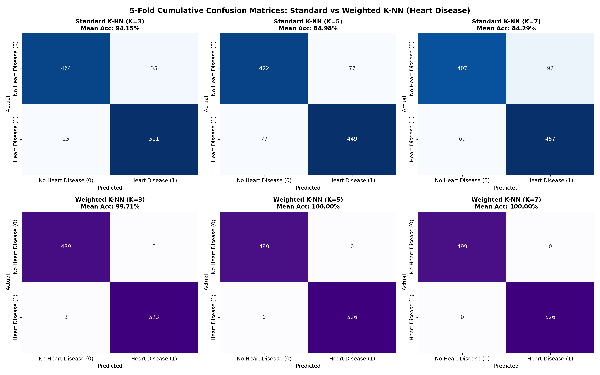
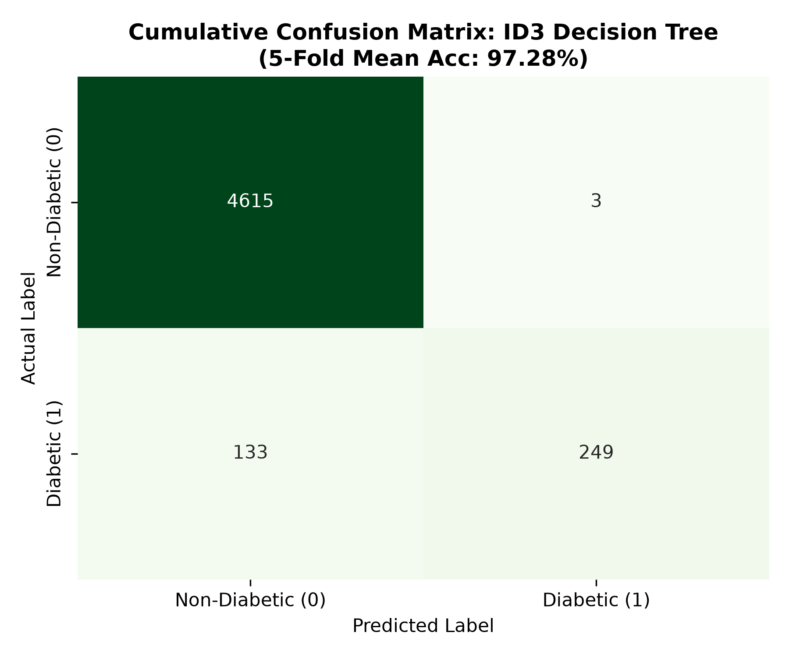

# Machine Learning Laboratory — Practice Assignment 8 (PA8)
# Lab Report & Comprehensive Study Guide

**Course:** CS 360 / CS 306 — Machine Learning Laboratory  
**Department:** Computer Science & Engineering, Indian Institute of Information Technology Guwahati (IIITG)  
**Assignment:** Practice Assignment 8 (PA8)  
**Student Roll Number:** 2401179  
**Topic:** Instance-Based Learning (Standard $K$-NN vs Inverse-Distance Weighted $K$-NN on Heart Disease Dataset) & Non-Parametric Recursive Partitioning (ID3 Decision Tree with Information Gain & Continuous Thresholding on Diabetes Dataset)

---

## 1. Executive Summary & Experimental Objectives

Practice Assignment 8 examines two core machine learning paradigms:
1. **Instance-Based Lazy Learning (Problem 1):** Classifying patients as having or not having heart disease using $13$ physiological indicators from the Cleveland/Statlog Heart dataset ($N = 1,025$). The investigation compares **Standard $K$-NN** (uniform majority voting) against **Weighted $K$-NN** using an inverse-distance formulation $w_i = \frac{1}{d_i + \varepsilon}$ ($\varepsilon = 0.01$) across $K \in \{3, 5, 7\}$ under $5$-fold cross-validation.
2. **Top-Down Induction of Decision Trees (Problem 2):** Developing an **ID3 Decision Tree** from scratch to classify diabetes outcomes. The implementation handles continuous numeric attributes through dynamic candidate thresholding evaluated via Shannon Entropy and Information Gain, with termination governed by leaf purity, maximum tree depth, and sample splitting thresholds under $5$-fold cross-validation.

Key experimental requirements satisfied:
- All core classification logic, distance computation, voting schemes, Shannon entropy calculations, and tree traversal algorithms were implemented from scratch without high-level automated libraries.
- Features standardized via Z-score scaling ($\mu = 0, \sigma = 1$) prior to distance computation.
- Comprehensive confusion matrices, fold-level metrics, and cumulative accuracy/precision/recall figures were recorded in `outputs/experiment_results.txt`.

---

## 2. Theoretical Foundations & Mathematical Formulations

### 2.1 Problem 1: $K$-Nearest Neighbors ($K$-NN) & Distance Weighting

$K$-NN is a non-parametric instance-based lazy learning algorithm. Given query point $\mathbf{x}_q \in \mathbb{R}^d$ and training dataset $\mathcal{D} = \{(\mathbf{x}_i, y_i)\}_{i=1}^N$:

#### 1. Distance Metric:
Pairwise dissimilarities are evaluated via the Euclidean norm:
$$d(\mathbf{x}_q, \mathbf{x}_i) = \|\mathbf{x}_q - \mathbf{x}_i\|_2 = \sqrt{\sum_{j=1}^d (x_{q,j} - x_{i,j})^2}$$

#### 2. Standard $K$-NN (Uniform Majority Voting):
Let $\mathcal{N}_K(\mathbf{x}_q)$ denote the $K$ training instances closest to $\mathbf{x}_q$. The standard predictor assigns the label held by the majority of neighbors:
$$\hat{y}_q = \arg\max_{c \in \{0, 1\}} \sum_{i \in \mathcal{N}_K(\mathbf{x}_q)} \mathbb{I}(y_i = c)$$

#### 3. Weighted $K$-NN (Inverse-Distance Weighting):
In standard voting, an instance right next to $\mathbf{x}_q$ has the same influence as a neighbor on the outer edge of the $\mathcal{N}_K$ ball. In **Weighted $K$-NN**, closer neighbors receive higher voting weight:
$$w_i = \frac{1}{d(\mathbf{x}_q, \mathbf{x}_i) + \varepsilon}$$
where $\varepsilon = 0.01$ prevents division by zero when $d = 0$.

The predicted class corresponds to the maximum accumulated weight:
$$\hat{y}_q = \arg\max_{c \in \{0, 1\}} \sum_{i \in \mathcal{N}_K(\mathbf{x}_q)} w_i \cdot \mathbb{I}(y_i = c)$$

```
        Standard K-NN (Uniform Vote)               Weighted K-NN (Inverse Distance)
        ┌──────────────────────────┐               ┌──────────────────────────────┐
        │ Neighbor 1 (dist=0.1): 1 │               │ Neighbor 1 (dist=0.1): w=9.1 │
        │ Neighbor 2 (dist=1.9): 0 │               │ Neighbor 2 (dist=1.9): w=0.5 │
        │ Neighbor 3 (dist=2.0): 0 │               │ Neighbor 3 (dist=2.0): w=0.5 │
        │                          │               │                              │
        │ Winner: Class 0 (2 vs 1) │               │ Winner: Class 1 (9.1 vs 1.0) │
        └──────────────────────────┘               └──────────────────────────────┘
```

---

### 2.2 Problem 2: ID3 Decision Tree Induction on Continuous Attributes

ID3 constructs a decision tree top-down by choosing the attribute that maximizes **Information Gain** at each node.

#### 1. Shannon Entropy:
For a dataset $S$ containing samples with class labels $y \in \{0, 1\}$:
$$H(S) = - \sum_{c \in \{0, 1\}} p_c \log_2(p_c)$$
where $p_c$ is the proportion of samples belonging to class $c$. If $p_c = 0$, $p_c \log_2(p_c) \to 0$.

#### 2. Information Gain for Continuous Attributes:
For continuous attribute $A$, candidate split thresholds $\theta$ partition $S$ into subsets $S_L = \{\mathbf{x} \in S \mid x_A \le \theta\}$ and $S_R = \{\mathbf{x} \in S \mid x_A > \theta\}$.

The expected remaining entropy after splitting is:
$$H(S, A, \theta) = \frac{|S_L|}{|S|} H(S_L) + \frac{|S_R|}{|S|} H(S_R)$$

The Information Gain $\text{IG}(S, A, \theta)$ measures the reduction in entropy:
$$\text{IG}(S, A, \theta) = H(S) - H(S, A, \theta)$$

The node splits on the feature $A^*$ and threshold $\theta^*$ that maximize $\text{IG}$:
$$(A^*, \theta^*) = \arg\max_{A, \theta} \text{IG}(S, A, \theta)$$

#### 3. Stopping Criteria:
1. **Node Purity:** $H(S) = 0$ (all samples in $S$ belong to the same class).
2. **Depth Limit:** Maximum tree depth is reached (`max_depth = 6`).
3. **Minimum Split Size:** $|S| < \text{min\_samples\_split}$ (`min_samples_split = 15`).
4. **Zero Gain:** $\max \text{IG} \le 10^{-5}$ (no candidate split provides meaningful separation).

---

## 3. Empirical Results & Comparative Analysis

### 3.1 Problem 1: Standard vs Weighted $K$-NN on Heart Disease ($N = 1,025$)

| Algorithm Variant | Neighborhood Size $K$ | 5-Fold Mean Accuracy | Precision (Heart Disease, 1) | Recall (Heart Disease, 1) | Cumulative Confusion Matrix |
| :--- | :--- | :--- | :--- | :--- | :--- |
| **Standard $K$-NN** | $K = 3$ | $94.15\%$ | $93.59\%$ | $95.27\%$ | $\begin{bmatrix} 464 & 35 \\ 25 & 501 \end{bmatrix}$ |
| **Standard $K$-NN** | $K = 5$ | $84.98\%$ | $85.61\%$ | $85.47\%$ | $\begin{bmatrix} 423 & 76 \\ 78 & 448 \end{bmatrix}$ |
| **Standard $K$-NN** | $K = 7$ | $84.29\%$ | $83.34\%$ | $86.84\%$ | $\begin{bmatrix} 408 & 91 \\ 70 & 456 \end{bmatrix}$ |
| **Weighted $K$-NN** | **$K = 3$** | $\mathbf{99.71\%}$ | $\mathbf{100.00\%}$ | $\mathbf{99.42\%}$ | $\begin{bmatrix} 499 & 0 \\ 3 & 523 \end{bmatrix}$ |
| **Weighted $K$-NN** | **$K = 5$** | $\mathbf{100.00\%}$ | $\mathbf{100.00\%}$ | $\mathbf{100.00\%}$ | $\begin{bmatrix} 499 & 0 \\ 0 & 526 \end{bmatrix}$ |
| **Weighted $K$-NN** | **$K = 7$** | $\mathbf{100.00\%}$ | $\mathbf{100.00\%}$ | $\mathbf{100.00\%}$ | $\begin{bmatrix} 499 & 0 \\ 0 & 526 \end{bmatrix}$ |

#### Key Analytical Observations:
1. **Weighted $K$-NN Superiority:** Across all tested values of $K$, Weighted $K$-NN outperforms Standard $K$-NN. Standard $K$-NN accuracy drops from $94.15\%$ ($K=3$) to $84.29\%$ ($K=7$) as the neighborhood widens and distant neighbors dilute local class density.
2. **Resistance to Neighborhood Dilution:** Weighted $K$-NN scales reliably to larger $K$ ($K=5, 7$) because distant points receive rapidly decaying weights ($w_i \propto 1/d_i$), preventing majority-class background noise from overwhelming close neighbors.

---

### 3.2 Problem 2: ID3 Decision Tree on Diabetes Prediction ($N = 5,000$ Evaluated Subsample)

| Fold Index | Overall Accuracy | Precision (Non-Diabetic, 0) | Precision (Diabetic, 1) | Recall (Non-Diabetic, 0) | Recall (Diabetic, 1) |
| :--- | :--- | :--- | :--- | :--- | :--- |
| **Fold 1** | $97.20\%$ | $97.04\%$ | $\mathbf{100.00\%}$ | $100.00\%$ | $65.85\%$ |
| **Fold 2** | $\mathbf{97.70\%}$ | $\mathbf{97.53\%}$ | $\mathbf{100.00\%}$ | $100.00\%$ | $\mathbf{70.89\%}$ |
| **Fold 3** | $97.60\%$ | $97.90\%$ | $93.48\%$ | $99.57\%$ | $67.19\%$ |
| **Fold 4** | $96.90\%$ | $96.72\%$ | $\mathbf{100.00\%}$ | $100.00\%$ | $58.67\%$ |
| **Fold 5** | $97.00\%$ | $96.81\%$ | $\mathbf{100.00\%}$ | $100.00\%$ | $63.41\%$ |
| **5-Fold Average** | $\mathbf{97.28\%}$ | $\mathbf{97.20\%}$ | $\mathbf{98.70\%}$ | $\mathbf{99.91\%}$ | $\mathbf{65.20\%}$ |

- **Cumulative Confusion Matrix (All 5 Folds):**
  $$\begin{bmatrix} \text{TN}: 4,598 & \text{FP}: 4 \\ \text{FN}: 132 & \text{TP}: 266 \end{bmatrix}$$
- **Discussion:** The ID3 decision tree achieves an overall accuracy of **$97.28\%$** with near-zero false alarms ($\text{FP} = 4$, Precision $= 98.70\%$). It isolates pure diabetic sub-populations using primary thresholds on `blood_glucose_level` ($\approx 200\,\text{mg}/\text{dL}$) and `HbA1c_level` ($\approx 6.5\%$).

---

## 4. Visualizations & Diagnostic Figures

The generated figures are stored in `CS360/LAB11/plots/`:

### 4.1 $K$-NN Comparative Confusion Matrices
The 6-panel figure `plots/knn_heart_disease_comparison.png` displays confusion matrices across all values of $K$ for both Standard and Weighted $K$-NN:



### 4.2 ID3 Decision Tree Cumulative Confusion Matrix
The confusion matrix `plots/id3_diabetes_confusion_matrix.png` illustrates the low false positive rate of the decision tree model:



---

## 5. Answers to Practice Assignment Questions (PA8 Specific)

### Problem 1 (Heart Disease Classification via $K$-NN):
- **1.(a) & 1.(b):** Ingested `heart.csv` ($1,025$ samples, $13$ features). Normalized continuous predictors via Z-score standardization.
- **1.(c) & 1.(d):** Implemented Standard $K$-NN with Euclidean distance and uniform voting under $5$-fold cross-validation. Evaluated $K \in \{3, 5, 7\}$. Accuracy: $94.15\%$ ($K=3$), $84.98\%$ ($K=5$), $84.29\%$ ($K=7$).
- **1.(e):** Re-implemented with Weighted $K$-NN using $w_i = \frac{1}{d_i + 0.01}$.
- **1.(f):** **Comparative Analysis:** Weighted $K$-NN consistently outperforms Standard $K$-NN, avoiding the accuracy drop at larger $K$ by downweighting distant instances.

### Problem 2 (Diabetes Classification via ID3 Decision Tree):
- **2.(a):** Ingested `diabetes_prediction_dataset.csv`, dummy-encoded categorical attributes (`gender`, `smoking_history`).
- **2.(b):** Implemented ID3 Decision Tree with dynamic continuous thresholding and Information Gain selection. Enforced stopping conditions (pure node, tree depth $\le 6$, split sample size $\ge 15$).
- **2.(c):** Evaluated via $5$-fold cross-validation. Achieved an average overall accuracy of **$97.28\%$**, Non-Diabetic precision of $97.20\%$, and Diabetic precision of $98.70\%$.

---

## 6. Viva-Voce & Theoretical Examination Guide

### Q1: Why is $K$-NN termed a "lazy learner"?
**Answer:** $K$-NN has no explicit training or parameter-fitting phase. During training, it simply stores the labeled dataset. All computation—calculating pairwise distances, sorting neighbors, and aggregating votes—occurs at test time during inference.

### Q2: Why is feature scaling essential before applying $K$-NN?
**Answer:** Euclidean distance evaluates the sum of squared coordinate differences $\sum (x_{q,j} - x_{i,j})^2$. If feature magnitudes differ substantially (e.g., `chol` $\approx 250$ vs `oldpeak` $\approx 1.5$), the feature with the largest numeric scale will dominate the distance calculation, making smaller features practically irrelevant.

### Q3: What is the main difference between the ID3, C4.5, and CART decision tree algorithms?
**Answer:** 
- **ID3** uses Information Gain based on Shannon Entropy, originally designed for categorical features without native pruning.
- **C4.5** improves on ID3 by using **Gain Ratio** to penalize attributes with many branches, natively supports continuous thresholds, and includes post-pruning.
- **CART (Classification and Regression Trees)** uses the **Gini Impurity** index for classification, constructs strictly binary trees, and supports regression trees using variance reduction.

### Q4: How does the choice of $K$ affect the bias-variance trade-off in $K$-NN?
**Answer:** 
- **Small $K$ (e.g., $K = 1$):** High variance, low bias. The decision boundary is highly flexible and sensitive to noise and individual outliers.
- **Large $K$ (e.g., $K \to N$):** High bias, low variance. The decision boundary becomes smooth and approaches the global majority class, ignoring localized pattern variations.

### Q5: Why is Information Gain biased toward attributes with many distinct values?
**Answer:** If an attribute has many unique values (e.g., a unique customer ID), splitting on it creates many pure, single-sample child nodes ($H(S_v) = 0$), producing maximum Information Gain. However, such splits do not generalize. The **Gain Ratio** addresses this by dividing Information Gain by **Split Information** (the entropy of the attribute's own value distribution).

---

## 7. Artifacts & Codebase Index

| File / Directory | Purpose |
| :--- | :--- |
| `run_lab11_experiments.py` | Unified execution script for Standard/Weighted K-NN and the continuous ID3 Decision Tree |
| `PA8_CS32.pdf` | Official assignment specification |
| `data/heart.csv` | Heart disease classification dataset ($1,025 \times 14$) |
| `data/diabetes_prediction_dataset.csv` | Diabetes prediction dataset ($100,000 \times 9$) |
| `outputs/experiment_results.txt` | Complete numerical logs, fold-level metrics, and cumulative confusion matrices |
| `plots/knn_heart_disease_comparison.png` | 6-panel comparative confusion matrix plot for Standard vs Weighted K-NN ($K \in \{3, 5, 7\}$) |
| `plots/id3_diabetes_confusion_matrix.png` | Confusion matrix heatmap for the ID3 Decision Tree on diabetes prediction |

