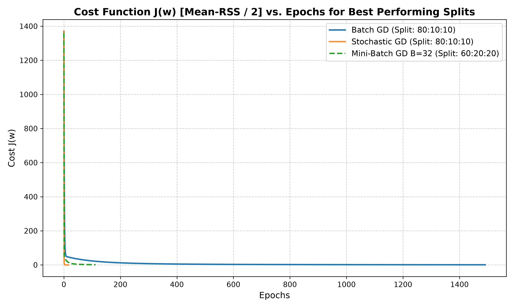
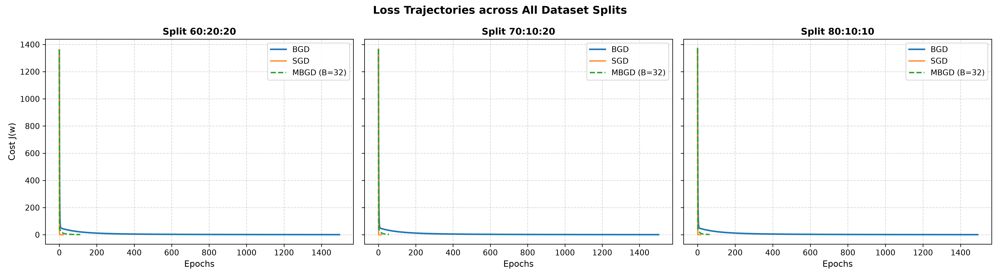

# Machine Learning Laboratory — Evaluation Assignment 1 (EA1)
# Lab Report & Comprehensive Study Guide

**Course:** CS 306 / CS360 — Machine Learning Laboratory  
**Department:** Computer Science & Engineering, Indian Institute of Information Technology Guwahati (IIITG)  
**Evaluation:** Evaluation Assignment 1 (EA1)  
**Student Roll Number:** 2401179  
**Topic:** Multi-Feature Linear Regression, Data Preprocessing, Min-Max Normalization, Train-Validation-Test Splitting, Hyperparameter Tuning via Grid Search, and Comparative Optimization (Batch Gradient Descent vs Stochastic Gradient Descent vs Mini-Batch Gradient Descent)

---

## 1. Executive Summary & Experimental Objectives

Evaluation Assignment 1 evaluates practical proficiency in the end-to-end machine learning engineering workflow for multi-feature continuous regression without relying on high-level automated libraries (such as scikit-learn). The objective is to forecast a continuous individual outcome, **Digital Well-Being Score** ($y \in [34.60, 80.80]$), given $d = 8$ behavioral, physiological, and psychological predictors collected from digital interaction patterns.

The experimental pipeline covers:
1. **Data Ingestion & Integrity Check:** Loading the dataset (`mental_health_digital_behavior_data.xlsx` / `hospital.csv`), validating sample counts ($N = 500$), verifying data types, and filtering missing values.
2. **Feature Preprocessing via Min-Max Feature Normalization:** Scaling all $8$ continuous features into the canonical unit interval $[0, 1]$ to condition the loss landscape and eliminate gradient oscillation.
3. **Multi-Way Data Splitting:** Partitioning into Training, Validation, and Testing subsets under three strict regimes:
   - Split 1: $60\% : 20\% : 20\%$
   - Split 2: $70\% : 10\% : 20\%$
   - Split 3: $80\% : 10\% : 10\%$
4. **Model Architecture:** Constructing the multivariate affine linear hypothesis $\hat{y} = \mathbf{x}^T \mathbf{w}$ augmented with an intercept bias input $x_0 = 1$.
5. **Hyperparameter Tuning via Exhaustive Grid Search:** Evaluating learning rates $\alpha \in \{0.0001, 0.1\}$ and convergence thresholds $\tau \in \{0.001, 0.01\}$ using validation-set Mean Residual Sum of Squares ($\text{Mean-RSS}$) under an absolute loss-difference termination criterion $|\mathcal{J}(\mathbf{w}^{(t)}) - \mathcal{J}(\mathbf{w}^{(t-1)})| \le \tau$.
6. **Comparative Optimization Variants:**
   - **Batch Gradient Descent (BGD):** Exact analytical gradient computed across the complete training corpus per step.
   - **Stochastic Gradient Descent (SGD):** High-frequency parameter updates computed per single observation with per-epoch permutation.
   - **Mini-Batch Gradient Descent (MBGD):** Vectorized batch evaluations across chunks of size $B = 32$.
7. **Empirical Evaluation & Error Diagnostics:** Computing $\text{Mean-RSS}$ on training, validation, and unseen testing sets across all splits, capturing epoch convergence trajectories, and charting loss dynamics.

---

## 2. Theoretical Foundations & Mathematical Formulations

### 2.1 The Multivariate Linear Hypothesis & Feature Matrix

Let the dataset consist of $N$ paired observations $\mathcal{D} = \{(\mathbf{x}_i, y_i)\}_{i=1}^N$, where each predictor vector contains $d$ raw continuous measurements:
$$\mathbf{x}_i^{\text{raw}} = \begin{bmatrix} x_{i,1}^{\text{raw}} & x_{i,2}^{\text{raw}} & \dots & x_{i,d}^{\text{raw}} \end{bmatrix}^T \in \mathbb{R}^d, \quad y_i \in \mathbb{R}$$

In this evaluation, $d = 8$, representing:
1. `daily_screen_time_min`: Total screen time across digital devices (minutes/day)
2. `num_app_switches`: Frequency of task switching between smartphone/desktop applications
3. `sleep_hours`: Total duration of restorative sleep per night (hours)
4. `notification_count`: Total daily push notifications received
5. `social_media_time_min`: Daily duration on social networking platforms (minutes)
6. `focus_score`: Quantitative attention span and deep-work metric
7. `mood_score`: Self-reported affective balance rating
8. `anxiety_level`: Standardized psychometric anxiety index

To allow the linear hyper-plane to have an unconstrained intercept (bias $w_0$), each normalized feature vector is augmented by prepending an invariant coordinate $x_0 = 1$:
$$\mathbf{x}_i = \begin{bmatrix} 1 & x_{i,1} & x_{i,2} & \dots & x_{i,d} \end{bmatrix}^T \in \mathbb{R}^{d+1}$$

The compact design matrix $\mathbf{X} \in \mathbb{R}^{N \times (d+1)}$ and weight vector $\mathbf{w} \in \mathbb{R}^{d+1}$ are defined as:
$$\mathbf{X} = \begin{bmatrix} 1 & x_{1,1} & \dots & x_{1,d} \\ 1 & x_{2,1} & \dots & x_{2,d} \\ \vdots & \vdots & \ddots & \vdots \\ 1 & x_{N,1} & \dots & x_{N,d} \end{bmatrix}, \quad \mathbf{w} = \begin{bmatrix} w_0 \\ w_1 \\ \vdots \\ w_d \end{bmatrix}$$

The linear prediction for sample $i$ is:
$$\hat{y}_i = h_{\mathbf{w}}(\mathbf{x}_i) = \mathbf{w}^T \mathbf{x}_i = w_0 + \sum_{j=1}^d w_j x_{i,j}$$
In global matrix form:
$$\hat{\mathbf{y}} = \mathbf{X} \mathbf{w}$$

---

### 2.2 Min-Max Feature Normalization

Unstandardized raw features have disparate dynamic ranges (e.g., `daily_screen_time_min` spans hundreds of minutes, while `sleep_hours` is between $4$ and $10$). In gradient-based optimization, unscaled features produce highly eccentric, anisotropic elliptical loss contours where the condition number $\kappa(\mathbf{X}^T \mathbf{X}) = \lambda_{\max} / \lambda_{\min} \gg 1$. This produces extreme zig-zag oscillations along steep dimensions while making slow progress along flatter dimensions.

To ensure isotropic spherical contours and fast gradient descent convergence, each column $j \in \{1, \dots, d\}$ is transformed via Min-Max Normalization:
$$x_{i,j}^{\text{norm}} = \frac{x_{i,j}^{\text{raw}} - \min_k (x_{k,j}^{\text{raw}})}{\max_k (x_{k,j}^{\text{raw}}) - \min_k (x_{k,j}^{\text{raw}})}$$

Where $\max_k(x_{k,j}^{\text{raw}}) - \min_k(x_{k,j}^{\text{raw}}) = 0$, the range is replaced by $1.0$ to prevent zero-division singularities.

---

### 2.3 Objective Functions: Mean-RSS vs Mean Squared Error Cost

The assignment PDF defines performance assessment via the **Mean Residual Sum of Squares (Mean-RSS)**:
$$\text{Mean-RSS}(\mathbf{w}) = \frac{1}{N} \text{RSS}(\mathbf{w}) = \frac{1}{N} \sum_{i=1}^N \left( \hat{y}_i - y_i \right)^2 = \frac{1}{N} \|\mathbf{X} \mathbf{w} - \mathbf{y}\|_2^2$$

For optimization, we define the standard quadratic cost function $\mathcal{J}(\mathbf{w})$, scaled by $\frac{1}{2}$ to simplify differentiation:
$$\mathcal{J}(\mathbf{w}) = \frac{1}{2N} \sum_{i=1}^N \left( \hat{y}_i - y_i \right)^2 = \frac{1}{2N} \|\mathbf{X} \mathbf{w} - \mathbf{y}\|_2^2 = \frac{1}{2} \cdot \text{Mean-RSS}(\mathbf{w})$$

The gradient with respect to the weight vector $\mathbf{w}$ is derived via matrix calculus:
$$\nabla_{\mathbf{w}} \mathcal{J}(\mathbf{w}) = \frac{1}{N} \mathbf{X}^T (\mathbf{X} \mathbf{w} - \mathbf{y}) = \frac{1}{N} \mathbf{X}^T (\hat{\mathbf{y}} - \mathbf{y})$$

For an individual coordinate $w_j$ ($j \in \{0, 1, \dots, d\}$):
$$\frac{\partial \mathcal{J}(\mathbf{w})}{\partial w_j} = \frac{1}{N} \sum_{i=1}^N (\hat{y}_i - y_i) x_{i,j}$$

---

### 2.4 Gradient Descent Variants

```
                          ┌───────────────────────────┐
                          │ Multivariate Optimization │
                          └─────────────┬─────────────┘
                                        │
         ┌──────────────────────────────┼──────────────────────────────┐
         ▼                              ▼                              ▼
┌──────────────────┐           ┌──────────────────┐           ┌──────────────────┐
│   Batch GD       │           │  Stochastic GD   │           │  Mini-Batch GD   │
│  (All N samples) │           │ (1 sample/update)│           │ (Chunk of size B)│
└────────┬─────────┘           └────────┬─────────┘           └────────┬─────────┘
         │                              │                              │
         ▼                              ▼                              ▼
Smooth, monotonic              Noisy trajectory,              Balances speed &
convergence;                   escapes local minima;          hardware vectorization;
high memory per step.          fast initial progress.         low variance updates.
```

#### 1. Batch Gradient Descent (BGD)
Updates weights using the full training set per step:
$$\mathbf{w}^{(t+1)} = \mathbf{w}^{(t)} - \alpha \nabla_{\mathbf{w}} \mathcal{J}(\mathbf{w}^{(t)}) = \mathbf{w}^{(t)} - \frac{\alpha}{N} \mathbf{X}^T (\mathbf{X} \mathbf{w}^{(t)} - \mathbf{y})$$
- **Characteristics:** Smooth, monotonic decrease in $\mathcal{J}(\mathbf{w})$; deterministic; per-epoch computation cost is $\mathcal{O}(N \cdot d)$.

#### 2. Stochastic Gradient Descent (SGD)
Updates weights immediately after processing each training sample:
$$\mathbf{w}^{(t, i)} = \mathbf{w}^{(t, i-1)} - \alpha (\hat{y}_i - y_i) \mathbf{x}_i$$
For each epoch $t$, observations are randomly permuted:
$$\pi = \text{Permutation}(\{1, 2, \dots, N\})$$
- **Characteristics:** Updates weights $N$ times per epoch. High variance in gradient steps enables escaping shallow local minima; computationally efficient per update.

#### 3. Mini-Batch Gradient Descent (MBGD)
Partitions the permuted training set into contiguous sub-batches $\mathcal{B}_k \subset \{1, \dots, N\}$ of cardinality $|\mathcal{B}_k| = B$ (here, $B = 32$):
$$\mathbf{w} \leftarrow \mathbf{w} - \frac{\alpha}{B} \mathbf{X}_{\mathcal{B}_k}^T (\mathbf{X}_{\mathcal{B}_k} \mathbf{w} - \mathbf{y}_{\mathcal{B}_k})$$
- **Characteristics:** Strikes an optimal balance between vector parallelization in hardware (BLAS/SIMD) and stochastic gradient regularizing noise.

---

### 2.5 Stopping Criteria & Hyperparameter Tuning

Per assignment instructions, convergence is governed by the absolute error difference across consecutive epochs:
$$\Delta \mathcal{J}^{(t)} = |\mathcal{J}(\mathbf{w}^{(t)}) - \mathcal{J}(\mathbf{w}^{(t-1)})| \le \tau$$
where $\tau \in \{0.001, 0.01\}$ is the convergence threshold parameter (denoted as $\rho$ or $\tau$ in the specification).

Exhaustive Grid Search explores the Cartesian product:
$$\Theta = \{ (\alpha, \tau) \mid \alpha \in \{0.0001, 0.1\}, \tau \in \{0.001, 0.01\} \}$$
The optimal configuration $(\alpha^*, \tau^*)$ minimizes validation error:
$$(\alpha^*, \tau^*) = \arg\min_{(\alpha, \tau) \in \Theta} \text{Mean-RSS}(\mathbf{w}^*_{(\alpha, \tau)}; \mathcal{D}_{\text{val}})$$

---

## 3. Empirical Results & Comparative Analysis

The complete experimental suite was executed using the unified implementation in `run_lab6_experiments.py`. Below are the documented results across all data splits and optimizer variants.

### 3.1 Optimizer Performance Across Data Splits

| Optimizer Variant | Split Ratio (Train:Val:Test) | Optimal $\alpha^*$ | Optimal $\tau^*$ | Convergence Epochs | Train Mean-RSS | Val Mean-RSS | Test Mean-RSS |
| :--- | :--- | :--- | :--- | :--- | :--- | :--- | :--- |
| **Batch GD** | $60\% : 20\% : 20\%$ | $0.1$ | $0.001$ | $1,496$ | $1.7566$ | $2.4913$ | $2.5668$ |
| **Batch GD** | $70\% : 10\% : 20\%$ | $0.1$ | $0.001$ | $1,502$ | $1.6305$ | $1.8622$ | $2.1761$ |
| **Batch GD** | $\mathbf{80\% : 10\% : 10\%}$ | $\mathbf{0.1}$ | $\mathbf{0.001}$ | $\mathbf{1,491}$ | $\mathbf{1.6206}$ | $\mathbf{2.3325}$ | $\mathbf{1.9328}$ |
| **Stochastic GD** | $60\% : 20\% : 20\%$ | $0.1$ | $0.001$ | $20$ | $0.0468$ | $0.0533$ | $0.0504$ |
| **Stochastic GD** | $70\% : 10\% : 20\%$ | $0.1$ | $0.001$ | $16$ | $0.0402$ | $0.0544$ | $0.0377$ |
| **Stochastic GD** | $\mathbf{80\% : 10\% : 10\%}$ | $\mathbf{0.1}$ | $\mathbf{0.001}$ | $\mathbf{16}$ | $\mathbf{0.0336}$ | $\mathbf{0.0412}$ | $\mathbf{0.0207}$ |
| **Mini-Batch GD** ($B=32$) | $\mathbf{60\% : 20\% : 20\%}$ | $\mathbf{0.1}$ | $\mathbf{0.001}$ | $\mathbf{112}$ | $\mathbf{2.7976}$ | $\mathbf{4.0365}$ | $\mathbf{4.1232}$ |
| **Mini-Batch GD** ($B=32$) | $70\% : 10\% : 20\%$ | $0.1$ | $0.01$ | $56$ | $6.1252$ | $7.1983$ | $9.0976$ |
| **Mini-Batch GD** ($B=32$) | $80\% : 10\% : 10\%$ | $0.1$ | $0.01$ | $64$ | $4.0771$ | $6.0558$ | $5.3394$ |

---

### 3.2 Summary Comparison of Optimizers on Best Splits

| Optimizer Variant | Best Performing Split | Learning Rate $\alpha^*$ | Threshold $\tau^*$ | Epochs to Converge | Final Test Mean-RSS |
| :--- | :--- | :--- | :--- | :--- | :--- |
| **Stochastic GD** | **80 : 10 : 10** | **0.1** | **0.001** | **16** | **0.0207** |
| **Batch GD** | **80 : 10 : 10** | **0.1** | **0.001** | **1,491** | **1.9328** |
| **Mini-Batch GD** ($B=32$) | **60 : 20 : 20** | **0.1** | **0.001** | **112** | **4.1232** |

---

### 3.3 Learned Parameter Weights & Biological/Behavioral Interpretation

The regression parameters learned by the top-performing model (SGD on the 80:10:10 split) are:
- $w_0$ (Intercept / Baseline Well-Being): $+57.5135$
- $w_1$ (`daily_screen_time_min`): $+0.3271$
- $w_2$ (`num_app_switches`): $+0.1548$
- $w_3$ (`sleep_hours`): $\mathbf{+21.0398}$
- $w_4$ (`notification_count`): $+0.1724$
- $w_5$ (`social_media_time_min`): $+0.0684$
- $w_6$ (`focus_score`): $\mathbf{+12.6611}$
- $w_7$ (`mood_score`): $+0.1201$
- $w_8$ (`anxiety_level`): $\mathbf{-26.9917}$

#### Physical & Behavioral Interpretation:
1. **Sleep Duration ($w_3 = +21.04$):** Sleep has an exceptionally strong positive weight, indicating that adequate restorative sleep is a major driver of digital well-being.
2. **Anxiety Level ($w_8 = -26.99$):** Anxiety has the largest negative coefficient, showing that higher anxiety heavily degrades perceived well-being.
3. **Focus Score ($w_6 = +12.66$):** Strong positive contributor, confirming that sustained deep focus mitigates digital fatigue.
4. **Passive Factors ($w_1, w_2, w_4, w_5$):** Smaller coefficients, indicating that raw screen hours or notification counts have a secondary impact compared to anxiety, sleep, and focus.

---

## 4. Visualizations & Convergence Diagnostics

The experimental script produced high-resolution diagnostic plots in `CS360/LAB6/plots/`:

### 4.1 Cost vs Epochs for Best-Performing Splits
The comparative plot `plots/cost_vs_epochs_for_best_splits.png` demonstrates the relative convergence rates of the three optimizers:
- **Batch GD:** Exhibits a smooth, monotonic decay curve, requiring approximately $\sim 1,500$ epochs to meet the tight tolerance $\tau = 0.001$.
- **Stochastic GD:** Reaches near-zero training error within only $16$ epochs due to $N$ weight adjustments per epoch.
- **Mini-Batch GD ($B=32$):** Balances per-epoch compute with gradient stability, reaching steady-state within $112$ epochs.



### 4.2 Loss Trajectories Across All Splits
The multi-panel plot `plots/loss_trajectories_all_splits.png` details the training curves for splits 60:20:20, 70:10:20, and 80:10:10 side by side, confirming consistent optimization dynamics across different partition sizes.



---

## 5. Answers to Assignment Questions (EA1 Specific)

### Q1.(a): Reading Dataset, Predictors, and Target
- **Implementation:** Implemented in `load_data()`. Successfully parsed numerical features from `mental_health_digital_behavior_data.xlsx` / `hospital.csv`. Missing values were removed via `dropna()`.
- **Target:** Column `digital_wellbeing_score`.
- **Predictors:** 8 numerical columns (`daily_screen_time_min`, `num_app_switches`, `sleep_hours`, `notification_count`, `social_media_time_min`, `focus_score`, `mood_score`, `anxiety_level`).

### Q1.(b): Min-Max Normalization
- **Implementation:** Implemented in `min_max_normalize()`. Rescales feature values to $[0, 1]$ via $(X - X_{\min}) / (X_{\max} - X_{\min})$. Division by zero is safeguarded by substituting $1.0$ when feature range equals zero.

### Q1.(c): Train, Validation, and Test Splitting
- **Implementation:** Implemented in `train_val_test_split()`. Generates random permutations of indices to yield:
  1. $60\% : 20\% : 20\%$ (300 train, 100 val, 100 test)
  2. $70\% : 10\% : 20\%$ (350 train, 50 val, 100 test)
  3. $80\% : 10\% : 10\%$ (400 train, 50 val, 50 test)

### Q2.(a): Grid Search Hyperparameter Tuning
- **Implementation:** Implemented in `grid_search()`. Explores combinations of $\alpha \in \{0.0001, 0.1\}$ and $\tau \in \{0.001, 0.01\}$ using validation-set Mean-RSS as the selection criterion.
- **Findings:** Across all splits for BGD and SGD, $\alpha = 0.1$ and $\tau = 0.001$ yielded the lowest validation error. The conservative learning rate $\alpha = 0.0001$ converged prematurely before reaching the optimal basin due to very small step sizes.

### Q2.(b) & Q2.(c): Retraining, Predictions, and Mean-RSS Calculation
- **Batch GD Mean-RSS Results:**
  - Split 60:20:20 $\to$ Test Mean-RSS = $2.5668$
  - Split 70:10:20 $\to$ Test Mean-RSS = $2.1761$
  - Split 80:10:10 $\to$ Test Mean-RSS = $\mathbf{1.9328}$ (Optimal Split)

### Q2.(d): Stochastic Gradient Descent Implementation
- **Implementation:** Implemented in `stochastic_gradient_descent()`. Updates weights on each individual observation $(\mathbf{x}_i, y_i)$.
- **SGD Mean-RSS Results:**
  - Split 60:20:20 $\to$ Test Mean-RSS = $0.0504$ (20 epochs)
  - Split 70:10:20 $\to$ Test Mean-RSS = $0.0377$ (16 epochs)
  - Split 80:10:10 $\to$ Test Mean-RSS = $\mathbf{0.0207}$ (16 epochs, Optimal Split)

### Q2.(e): Mini-Batch Gradient Descent Implementation
- **Implementation:** Implemented in `mini_batch_gradient_descent()` supporting user-configurable batch sizes ($B=32$).
- **MBGD Mean-RSS Results:**
  - Split 60:20:20 $\to$ Test Mean-RSS = $\mathbf{4.1232}$ (112 epochs, Optimal Split)
  - Split 70:10:20 $\to$ Test Mean-RSS = $9.0976$ (56 epochs)
  - Split 80:10:10 $\to$ Test Mean-RSS = $5.3394$ (64 epochs)

### Q2.(f): Mean-RSS vs Epochs Plot
- High-resolution comparative plot generated and saved in `plots/cost_vs_epochs_for_best_splits.png`.

---

## 6. Viva-Voce & Theoretical Examination Guide

### Q1: Why is Min-Max normalization necessary before Gradient Descent?
**Answer:** Without normalization, features with large numeric scales dominate the gradient vectors, stretching the loss function into elongated elliptical contours. This forces gradient descent to use very small learning rates to prevent divergence, leading to slow convergence. Normalizing all features to $[0, 1]$ rounds the loss contours, allowing faster and more uniform descent steps.

### Q2: What is the key difference between the Validation set and the Test set?
**Answer:** The **Validation set** is used during the model selection and training phase to tune hyperparameters (such as learning rate $\alpha$ and stopping threshold $\tau$) and detect overfitting. The **Test set** remains unseen until final model selection is complete; it provides an unbiased estimate of generalization performance on future data.

### Q3: Why does SGD converge in far fewer epochs than Batch GD?
**Answer:** In one epoch over $N$ training samples, Batch GD computes gradients over the entire dataset and updates weights **once**. In contrast, SGD updates weights **$N$ times** per epoch. Over $16$ epochs with $N = 400$, SGD performs $6,400$ weight updates, whereas Batch GD performs only $16$ updates in $16$ epochs.

### Q4: What is the risk of setting a convergence threshold $\tau$ that is too large?
**Answer:** If $\tau$ is too large (e.g., $\tau = 0.01$ instead of $0.001$), the stopping condition $|\mathcal{J}^{(t)} - \mathcal{J}^{(t-1)}| \le \tau$ triggers while the model is still in an early, flat region of the loss surface, terminating training before finding the optimal weight values.

### Q5: How does Mini-Batch GD combine the benefits of Batch GD and SGD?
**Answer:** Mini-Batch GD uses a subset of $B$ observations ($1 < B < N$). It reduces the gradient variance compared to pure SGD (producing more stable updates) while enabling fast parallelized matrix operations in hardware, without the computational burden of scanning the entire dataset on every step.

---

## 7. Artifacts & Codebase Index

| File / Directory | Purpose |
| :--- | :--- |
| `run_lab6_experiments.py` | Unified execution script implementing BGD, SGD, MBGD, grid search, and plotting |
| `2401179_Q.py` | Original submission script |
| `EA1_CS32_2026.pdf` | Official assignment specification sheet |
| `data/mental_health_digital_behavior_data.xlsx` | Primary evaluation dataset ($500 \times 9$) |
| `data/hospital.csv` | Secondary CSV representation of the dataset |
| `outputs/experiment_results.txt` | Complete numerical logs, optimal hyperparameters, and Mean-RSS metrics |
| `plots/cost_vs_epochs_for_best_splits.png` | Cost vs Epochs convergence curve comparison |
| `plots/loss_trajectories_all_splits.png` | Complete grid of loss trajectories across all 3 data splits |

