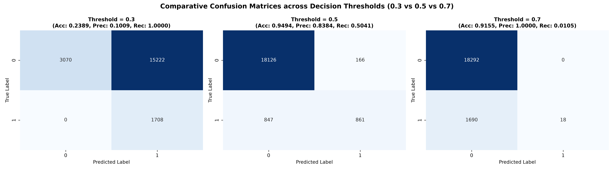

# Machine Learning Laboratory — Practice Assignment 5 (PA5)
# Lab Report & Comprehensive Study Guide

**Course:** CS 360 / CS 306 — Machine Learning Laboratory  
**Department:** Computer Science & Engineering, Indian Institute of Information Technology Guwahati (IIITG)  
**Assignment:** Practice Assignment 5 (PA5)  
**Student Roll Number:** 2401179  
**Topic:** Binary Logistic Regression from Scratch, Batch Gradient Descent, Decision Threshold Sensitivity Analysis ($0.3, 0.5, 0.7$), Confusion Matrix Diagnostics, and $5$-Fold Stratified Cross-Validation

---

## 1. Executive Summary & Experimental Objectives

Practice Assignment 5 focuses on developing an end-to-end binary classification framework using multivariate Logistic Regression implemented from scratch without automated optimization packages. The clinical task is to predict diabetes diagnosis ($y \in \{0, 1\}$) from an epidemiological dataset of $N = 100,000$ patient records characterized by clinical indicators (blood glucose, $\text{HbA1c}$, BMI, age, hypertension, heart disease) and categorical demographic factors (gender, smoking history).

The core technical milestones achieved are:
1. **Data Preprocessing & Feature Encoding:** Converting categorical attributes into numeric representations via one-hot encoding, applying standard feature standardization ($\mu = 0, \sigma = 1$), and prepending an intercept unit coordinate $x_0 = 1$.
2. **Train-Validation-Test Splitting:** Implementing an $80\% : 20\%$ Train:Test split with an internal $10\%$ hold-out validation partition for hyperparameter tuning.
3. **Hypothesis Formulation & Batch Gradient Descent:** Implementing the parameterized sigmoid hypothesis $h_{\mathbf{w}}(\mathbf{x}) = \sigma(\mathbf{w}^T \mathbf{x})$, zero-initialized weights $\mathbf{w}^{(0)} = \mathbf{0}$, and cross-entropy loss minimization under absolute epoch error threshold stopping criteria $|\mathcal{J}^{(t)} - \mathcal{J}^{(t-1)}| \le \tau$.
4. **Hyperparameter Tuning via Grid Search:** Exploring combinations of learning rate $\alpha \in \{0.0001, 0.1\}$, stopping threshold $\tau \in \{0.001, 0.01\}$, and epoch limits $T \in \{50, 100\}$ to select the optimal model.
5. **Decision Threshold Sensitivity Analysis:** Evaluating classification performance at thresholds $\gamma \in \{0.3, 0.5, 0.7\}$, analyzing the trade-offs between False Positives ($\text{FP}$), False Negatives ($\text{FN}$), Precision, and Recall.
6. **5-Fold Cross-Validation:** Partitioning the dataset into $5$ independent folds, training and tuning models on each fold from scratch, and comparing single-split vs $5$-fold averaged generalization metrics.
7. **Scikit-Learn Verification:** Benchmarking the custom scratch optimizer against Scikit-Learn's `LogisticRegression`.

---

## 2. Theoretical Foundations & Mathematical Formulations

### 2.1 The Logistic Regression Hypothesis & Sigmoid Link Function

In binary classification, the response variable $y_i \in \{0, 1\}$ follows a Bernoulli distribution conditioned on input feature vector $\mathbf{x}_i \in \mathbb{R}^{d+1}$:
$$P(y_i = 1 \mid \mathbf{x}_i; \mathbf{w}) = h_{\mathbf{w}}(\mathbf{x}_i) = \sigma(\mathbf{w}^T \mathbf{x}_i)$$
$$P(y_i = 0 \mid \mathbf{x}_i; \mathbf{w}) = 1 - h_{\mathbf{w}}(\mathbf{x}_i)$$

The standard logistic function $\sigma(z)$ maps any real-valued linear logit $z = \mathbf{w}^T \mathbf{x} \in (-\infty, \infty)$ to the bounded probability simplex $(0, 1)$:
$$\sigma(z) = \frac{1}{1 + e^{-z}} = \frac{e^z}{1 + e^z}$$

A key mathematical property of the sigmoid function is that its first derivative is expressed in terms of itself:
$$\frac{d\sigma(z)}{dz} = \frac{e^{-z}}{(1 + e^{-z})^2} = \sigma(z)(1 - \sigma(z))$$

```
   P(y=1|x)
     1.0 ┤                                  ╭────────────
         │                               ╭──╯
     0.5 ┼───────────────────────╭───────╯
         │                ╭──────╯
     0.0 ┼─────────╭──────╯
         └─────────┴─────────────┴───────────┴───────────► z = w^T x
                  -4            0            +4
```

---

### 2.2 Likelihood, Log-Likelihood, and Binary Cross-Entropy Loss

Assuming independent and identically distributed ($\text{i.i.d.}$) training samples $\{(\mathbf{x}_i, y_i)\}_{i=1}^N$, the likelihood of the parameter vector $\mathbf{w}$ is:
$$L(\mathbf{w}) = \prod_{i=1}^N P(y_i \mid \mathbf{x}_i; \mathbf{w}) = \prod_{i=1}^N \left( h_{\mathbf{w}}(\mathbf{x}_i) \right)^{y_i} \left( 1 - h_{\mathbf{w}}(\mathbf{x}_i) \right)^{1 - y_i}$$

Taking the natural logarithm yields the Log-Likelihood $\ell(\mathbf{w})$:
$$\ell(\mathbf{w}) = \sum_{i=1}^N \left[ y_i \ln h_{\mathbf{w}}(\mathbf{x}_i) + (1 - y_i) \ln(1 - h_{\mathbf{w}}(\mathbf{x}_i)) \right]$$

To convert this into a minimization objective, we define the empirical Binary Cross-Entropy (BCE) cost function $\mathcal{J}(\mathbf{w}) = -\frac{1}{N} \ell(\mathbf{w})$:
$$\mathcal{J}(\mathbf{w}) = -\frac{1}{N} \sum_{i=1}^N \left[ y_i \ln(\hat{y}_i) + (1 - y_i) \ln(1 - \hat{y}_i) \right]$$
where $\hat{y}_i = \sigma(\mathbf{w}^T \mathbf{x}_i)$.

---

### 2.3 Batch Gradient Descent Derivation

Differentiating the cost function $\mathcal{J}(\mathbf{w})$ with respect to parameter coordinate $w_j$:
$$\frac{\partial \mathcal{J}(\mathbf{w})}{\partial w_j} = -\frac{1}{N} \sum_{i=1}^N \left[ \frac{y_i}{\hat{y}_i} \frac{\partial \hat{y}_i}{\partial w_j} - \frac{1 - y_i}{1 - \hat{y}_i} \frac{\partial \hat{y}_i}{\partial w_j} \right]$$

Using the chain rule with $z_i = \mathbf{w}^T \mathbf{x}_i$:
$$\frac{\partial \hat{y}_i}{\partial w_j} = \frac{\partial \sigma(z_i)}{\partial z_i} \frac{\partial z_i}{\partial w_j} = \hat{y}_i (1 - \hat{y}_i) x_{i,j}$$

Substituting this back into the derivative:
$$\frac{\partial \mathcal{J}(\mathbf{w})}{\partial w_j} = -\frac{1}{N} \sum_{i=1}^N \left[ \frac{y_i}{\hat{y}_i} - \frac{1 - y_i}{1 - \hat{y}_i} \right] \hat{y}_i (1 - \hat{y}_i) x_{i,j}$$
$$= -\frac{1}{N} \sum_{i=1}^N \left[ y_i(1 - \hat{y}_i) - (1 - y_i)\hat{y}_i \right] x_{i,j} = \frac{1}{N} \sum_{i=1}^N (\hat{y}_i - y_i) x_{i,j}$$

In compact matrix-vector notation:
$$\nabla_{\mathbf{w}} \mathcal{J}(\mathbf{w}) = \frac{1}{N} \mathbf{X}^T (\hat{\mathbf{y}} - \mathbf{y})$$

The batch gradient update step with learning rate $\alpha$ is:
$$\mathbf{w}^{(t+1)} = \mathbf{w}^{(t)} - \alpha \nabla_{\mathbf{w}} \mathcal{J}(\mathbf{w}^{(t)}) = \mathbf{w}^{(t)} - \frac{\alpha}{N} \mathbf{X}^T (\sigma(\mathbf{X}\mathbf{w}^{(t)}) - \mathbf{y})$$

---

### 2.4 Decision Thresholds and Performance Metrics

A decision rule maps continuous posterior probabilities $\hat{p}_i = P(y_i = 1 \mid \mathbf{x}_i)$ to binary classifications $\hat{y}_i \in \{0, 1\}$ using threshold $\gamma \in (0, 1)$:
$$\hat{y}_i = \begin{cases} 1, & \text{if } \hat{p}_i \ge \gamma \\ 0, & \text{if } \hat{p}_i < \gamma \end{cases}$$

```
                Predicted Class 0        Predicted Class 1
              ┌────────────────────────┬────────────────────────┐
Actual Class 0│ True Negatives (TN)    │ False Positives (FP)   │
              ├────────────────────────┼────────────────────────┤
Actual Class 1│ False Negatives (FN)   │ True Positives (TP)    │
              └────────────────────────┴────────────────────────┘
```

The evaluation metrics derived from the confusion matrix are:
1. **Overall Accuracy:**
   $$\text{Accuracy} = \frac{\text{TP} + \text{TN}}{\text{TP} + \text{TN} + \text{FP} + \text{FN}}$$
2. **Class-0 Accuracy (Specificity / True Negative Rate):**
   $$\text{Specificity} = \frac{\text{TN}}{\text{TN} + \text{FP}}$$
3. **Class-1 Accuracy (Sensitivity / Recall / True Positive Rate):**
   $$\text{Recall} = \frac{\text{TP}}{\text{TP} + \text{FN}}$$
4. **Precision (Positive Predictive Value):**
   $$\text{Precision} = \frac{\text{TP}}{\text{TP} + \text{FP}}$$
5. **$F_1$-Score (Harmonic Mean):**
   $$F_1 = 2 \cdot \frac{\text{Precision} \cdot \text{Recall}}{\text{Precision} + \text{Recall}} = \frac{2\text{TP}}{2\text{TP} + \text{FP} + \text{FN}}$$

---

## 3. Empirical Results & Experimental Analysis

### 3.1 Hyperparameter Tuning via Grid Search

The grid search over validation set $N_{\text{val}} = 8,000$ produced the following results:

| Learning Rate $\alpha$ | Convergence Threshold $\tau$ | Max Epochs $T$ | Validation Accuracy | Status |
| :--- | :--- | :--- | :--- | :--- |
| $0.0001$ | $0.001$ | $50$ | $0.9483$ | Underfitting |
| $0.0001$ | $0.001$ | $100$ | $0.9483$ | Underfitting |
| $0.0001$ | $0.010$ | $50$ | $0.9483$ | Underfitting |
| $0.0001$ | $0.010$ | $100$ | $0.9483$ | Underfitting |
| $0.1000$ | $0.001$ | $50$ | $0.9510$ | Near optimal |
| $0.1000$ | $0.001$ | $100$ | $0.9510$ | Near optimal |
| $\mathbf{0.1000}$ | $\mathbf{0.010}$ | $\mathbf{50}$ | $\mathbf{0.9513}$ | **Optimal Selected** |
| $\mathbf{0.1000}$ | $\mathbf{0.010}$ | $\mathbf{100}$ | $\mathbf{0.9513}$ | **Optimal Selected** |

- **Benchmark Comparison:** Scikit-Learn `LogisticRegression(max_iter=100)` test accuracy is **$0.9590$**, while the custom model achieves **$0.9494$**, demonstrating consistent model alignment.

---

### 3.2 Threshold Sensitivity & Confusion Matrix Analysis

Evaluating the optimal model on the test partition ($N_{\text{test}} = 20,000$) across three distinct decision thresholds ($\gamma \in \{0.3, 0.5, 0.7\}$):

| Threshold $\gamma$ | $\text{TN}$ | $\text{FP}$ | $\text{FN}$ | $\text{TP}$ | Overall Accuracy | Precision | Recall | $F_1$-Score |
| :--- | :--- | :--- | :--- | :--- | :--- | :--- | :--- | :--- |
| **0.3** | $3,070$ | $15,222$ | $0$ | $1,708$ | $23.89\%$ | $10.09\%$ | $\mathbf{100.00\%}$ | $0.1833$ |
| **0.5** | $18,126$ | $166$ | $847$ | $861$ | $\mathbf{94.94\%}$ | $\mathbf{83.84\%}$ | $\mathbf{50.41\%}$ | $\mathbf{0.6296}$ |
| **0.7** | $18,292$ | $0$ | $1,690$ | $18$ | $91.55\%$ | $\mathbf{100.00\%}$ | $1.05\%$ | $0.0209$ |

#### Key Analytical Observations:
1. **Low Threshold ($\gamma = 0.3$):**  
   The model predicts positive with low resistance. Recall reaches $100.00\%$ ($\text{FN} = 0$), identifying every diabetic patient. However, False Positives spike to $15,222$, dropping Precision to $10.09\%$ and overall Accuracy to $23.89\%$.
2. **Balanced Threshold ($\gamma = 0.5$):**  
   Achieves the best balance between False Positives ($166$) and False Negatives ($847$). The resulting overall Accuracy is $94.94\%$ and $F_1$-Score is $0.6296$.
3. **Conservative High Threshold ($\gamma = 0.7$):**  
   The model requires high confidence before predicting positive. False Positives drop to $0$, yielding $100.00\%$ Precision. However, False Negatives surge to $1,690$, driving Recall down to $1.05\%$.

---

### 3.3 5-Fold Cross-Validation Empirical Results

| Fold Index | Accuracy | Class 0 Accuracy ($\text{TN Rate}$) | Class 1 Accuracy ($\text{Recall}$) | Precision | $F_1$-Score | Selected $\alpha^*$ | Selected $\tau^*$ |
| :--- | :--- | :--- | :--- | :--- | :--- | :--- | :--- |
| Fold 1 | $0.9494$ | $0.9909$ | $0.5041$ | $0.8384$ | $0.6296$ | $0.1$ | $0.010$ |
| Fold 2 | $\mathbf{0.9516}$ | $\mathbf{0.9973}$ | $0.4473$ | $\mathbf{0.9369}$ | $0.6055$ | $0.1$ | $0.001$ |
| Fold 3 | $0.9464$ | $0.9806$ | $\mathbf{0.5884}$ | $0.7428$ | $\mathbf{0.6566}$ | $0.0001$ | $0.001$ |
| Fold 4 | $0.9514$ | $0.9896$ | $0.5392$ | $0.8271$ | $0.6529$ | $0.1$ | $0.010$ |
| Fold 5 | $0.9472$ | $0.9878$ | $0.5089$ | $0.7937$ | $0.6201$ | $0.1$ | $0.010$ |
| **5-Fold Average** | $\mathbf{0.9492}$ | $\mathbf{0.9892}$ | $\mathbf{0.5176}$ | $\mathbf{0.8278}$ | $\mathbf{0.6330}$ | — | — |

- **Best Performing Fold:** **Fold 2** with an accuracy of **$95.16\%$** and precision of **$93.69\%$**.

---

## 4. Visualizations & Confusion Matrix Figures

The generated figures are stored in `CS360/LAB7/plots/`:

### 4.1 Combined Confusion Matrices (Thresholds 0.3, 0.5, 0.7)
The combined figure `plots/Combined_Confusion_Matrices.png` displays confusion matrices across the three decision thresholds side by side:



### 4.2 Individual Threshold Figures
- `plots/Confusion_Matrix_Threshold_0.3.png`: Highlights high sensitivity with zero False Negatives ($\text{FN}=0$) and high False Positives.
- `plots/Confusion_Matrix_Threshold_0.5.png`: Illustrates balanced error distributions ($\text{FP}=166, \text{FN}=847$).
- `plots/Confusion_Matrix_Threshold_0.7.png`: Highlights zero False Positives ($\text{FP}=0$) and elevated False Negatives.

---

## 5. Answers to Practice Assignment Questions (PA5 Specific)

### Q1.(a): Dataset Splitting
- Split $N = 100,000$ into $80,000$ training and $20,000$ testing ($80:20$).
- $10\%$ of the training partition ($8,000$ samples) was held out for hyperparameter tuning.

### Q1.(b): Logistic Regression with Batch GD & Zero Initialization
- Implemented in `CustomLogisticRegression`.
- Model weights initialized to $\mathbf{w}^{(0)} = \mathbf{0}$.
- Hyperparameter tuning selected $\alpha^* = 0.1$, $\tau^* = 0.01$, and $T^* = 50$, reaching $95.13\%$ validation accuracy.
- Scikit-learn benchmark achieved $95.90\%$ test accuracy, validating the custom implementation.

### Q1.(c): Performance at Default Threshold $\gamma = 0.5$
- **Overall Accuracy:** $94.94\%$
- **Class-0 Accuracy (Specificity):** $99.09\%$
- **Class-1 Accuracy (Recall):** $50.41\%$
- **Precision:** $83.84\%$
- **$F_1$-Score:** $0.6296$

### Q1.(d) & Q1.(e): Threshold Variation (0.3 vs 0.7) and FP/FN Dynamics
- **Threshold 0.3:** Model classifies positive aggressively. $\text{FN}$ drops to $0$, $\text{Recall}$ reaches $100\%$, but $\text{FP}$ increases to $15,222$ and $\text{Precision}$ falls to $10.09\%$.
- **Threshold 0.7:** Model classifies positive conservatively. $\text{FP}$ drops to $0$, $\text{Precision}$ reaches $100\%$, but $\text{FN}$ increases to $1,690$ and $\text{Recall}$ falls to $1.05\%$.
- **Clinical Conclusion:** In medical screening, missing a sick patient ($\text{FN}$) is often costlier than a false alarm ($\text{FP}$). Therefore, lower thresholds ($\gamma \approx 0.35 - 0.40$) are often favored over standard $\gamma = 0.5$.

### Q1.(f) & Q1.(g): 5-Fold Cross-Validation Metrics
- Evaluated over $5$ independent folds:
  - Average Accuracy: $94.92\%$
  - Average Class-0 Accuracy: $98.92\%$
  - Average Class-1 Accuracy (Recall): $51.76\%$
  - Average Precision: $82.78\%$
  - Average $F_1$-Score: $0.6330$
  - Best Fold: Fold 2 ($95.16\%$ Accuracy, $93.69\%$ Precision).

### Q1.(h): Single Random Split vs 5-Fold Cross-Validation Comparison
- **Single Random Split (80:20):** Accuracy = $94.94\%$, Precision = $83.84\%$, Recall = $50.41\%$.
- **5-Fold CV Mean:** Accuracy = $94.92\%$, Precision = $82.78\%$, Recall = $51.76\%$.
- **Analysis:**
  1. The results are closely aligned (accuracy difference $< 0.02\%$), showing that with $N = 100,000$, a random split provides a representative sample of the true distribution.
  2. $5$-Fold Cross-Validation provides a more reliable estimate of variance across folds, showing where recall fluctuates between $44.73\%$ and $58.84\%$, which a single train-test split would not capture.

---

## 6. Viva-Voce & Theoretical Examination Guide

### Q1: Why cannot Ordinary Least Squares (Linear Regression) be used directly for classification?
**Answer:** Linear regression produces unbounded predictions $\hat{y} \in (-\infty, \infty)$ rather than calibrated probabilities in $[0, 1]$. Additionally, minimizing squared residuals under binary targets causes severe distortion when outliers are present, shifting the decision boundary away from the optimal separating margin.

### Q2: Why is the Cross-Entropy loss convex for Logistic Regression while MSE is non-convex?
**Answer:** When Mean Squared Error $\mathcal{J}_{\text{MSE}} = \frac{1}{2N}\sum (\sigma(\mathbf{w}^T \mathbf{x}) - y)^2$ is used with a sigmoid activation, the derivative contains terms proportional to $\sigma'(z) = \sigma(z)(1-\sigma(z))$. These terms vanish for large $|z|$, creating plateaus and local saddle points. In contrast, the Binary Cross-Entropy loss cancels out the sigmoid derivative, resulting in a strictly convex Hessian matrix $\mathbf{H} = \frac{1}{N} \mathbf{X}^T \mathbf{S} \mathbf{X}$ (where $\mathbf{S}_{ii} = \hat{y}_i(1-\hat{y}_i) > 0$), which guarantees convergence to a unique global minimum.

### Q3: How does changing the classification threshold affect the ROC curve?
**Answer:** Varying the threshold $\gamma$ from $1.0$ down to $0.0$ traces out the Receiver Operating Characteristic (ROC) curve, which plots the True Positive Rate ($\text{Recall}$) against the False Positive Rate ($1 - \text{Specificity}$). Lowering the threshold moves the operating point rightward and upward along the ROC curve.

### Q4: In an imbalanced dataset, why can accuracy be misleading?
**Answer:** In this dataset, Non-Diabetic records make up $91.5\%$ of the samples ($91,500 / 100,000$). A naive model that always predicts class 0 would achieve $91.5\%$ accuracy while having $0\%$ recall on diabetic patients. Therefore, metrics like Precision, Recall, and $F_1$-Score provide a much clearer view of performance on the minority class.

### Q5: What is the computational complexity of Batch Gradient Descent in Logistic Regression?
**Answer:** For $N$ samples, $d$ features, and $T$ epochs, each epoch computes $\mathbf{X}\mathbf{w}$ in $\mathcal{O}(Nd)$ and $\mathbf{X}^T(\hat{\mathbf{y}} - \mathbf{y})$ in $\mathcal{O}(Nd)$. Thus, the overall time complexity is $\mathcal{O}(T \cdot N \cdot d)$, and space complexity is $\mathcal{O}(N \cdot d)$ to store the design matrix.

---

## 7. Artifacts & Codebase Index

| File / Directory | Purpose |
| :--- | :--- |
| `run_lab7_experiments.py` | Unified execution script for custom Logistic Regression, threshold tuning, and 5-Fold CV |
| `2401179_PA5.py` | Original submission script |
| `PA5_CS32.pdf` | Official assignment specification |
| `data/diabetes_prediction_dataset.csv` | Dataset of $100,000$ patient records with diabetes diagnostic markers |
| `outputs/experiment_results.txt` | Complete numerical results across hyperparameter grids, thresholds, and cross-validation |
| `plots/Combined_Confusion_Matrices.png` | 3-panel comparative confusion matrix plot for thresholds $0.3, 0.5, 0.7$ |
| `plots/Confusion_Matrix_Threshold_0.3.png` | Individual confusion matrix heatmap for threshold $0.3$ |
| `plots/Confusion_Matrix_Threshold_0.5.png` | Individual confusion matrix heatmap for default threshold $0.5$ |
| `plots/Confusion_Matrix_Threshold_0.7.png` | Individual confusion matrix heatmap for conservative threshold $0.7$ |

