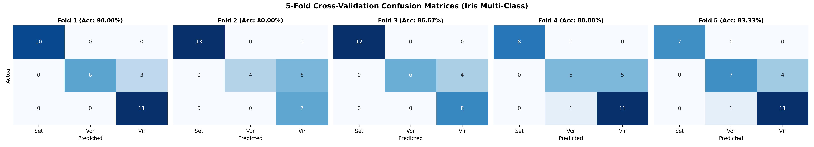
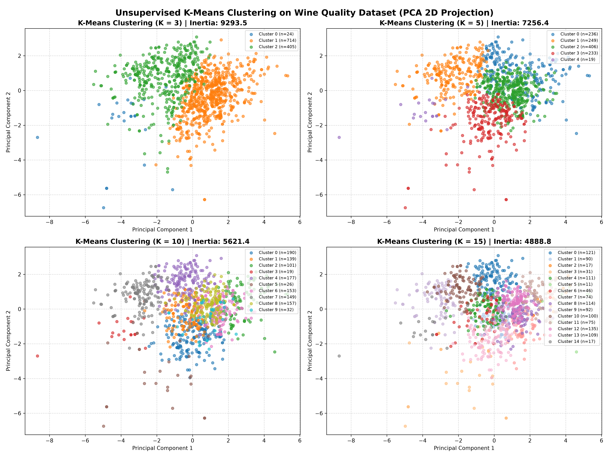

# Machine Learning Laboratory — Practice Assignment 6 (PA6)
# Lab Report & Comprehensive Study Guide

**Course:** CS 360 / CS 306 — Machine Learning Laboratory  
**Department:** Computer Science & Engineering, Indian Institute of Information Technology Guwahati (IIITG)  
**Assignment:** Practice Assignment 6 (PA6)  
**Student Roll Number:** 2401179  
**Topic:** Multi-Class Classification via One-vs-All Logistic Regression with $5$-Fold Cross-Validation (Iris Dataset) & Unsupervised Partitional Clustering via $K$-Means with PCA Projection (Wine Quality Dataset)

---

## 1. Executive Summary & Experimental Objectives

Practice Assignment 6 explores two fundamental machine learning paradigms:
1. **Supervised Multi-Class Classification (Problem 1):** Classifying the Iris flower species (*Iris setosa*, *Iris versicolor*, and *Iris virginica*) based on four morphological measurements using a from-scratch implementation of **Multi-Class Logistic Regression** with a **One-vs-All (OvA)** decomposition strategy and $5$-fold cross-validation.
2. **Unsupervised Partitional Clustering (Problem 2):** Discovering underlying latent groupings among $1,143$ wine samples characterized by $11$ continuous physicochemical attributes using a from-scratch **$K$-Means Clustering** algorithm across multiple cluster cardinalities $K \in \{3, 5, 10, 15\}$, evaluated via Within-Cluster Sum of Squares (Inertia/WCSS) and projected into $2\text{D}$ space via Principal Component Analysis (PCA).

The technical workflow satisfies all curriculum requirements:
- No automated machine learning libraries (such as scikit-learn) were used for model fitting or clustering.
- Model parameters are initialized to zero ($\boldsymbol{\theta}^{(0)} = \mathbf{0}$).
- Hyperparameter tuning via Grid Search tests combinations of learning rate $\alpha \in \{0.0001, 0.1\}$, convergence threshold $\tau \in \{0.001, 0.01\}$, and maximum epochs $T \in \{50, 100\}$.
- 5-Fold cross-validation is evaluated using confusion matrices, overall accuracy, class-wise accuracies, precision, and recall, with results compiled in `outputs/Problem1_Results.xlsx` and `outputs/experiment_results.txt`.
- K-Means termination is governed by zero point reassignments between consecutive iterations.

---

## 2. Theoretical Foundations & Mathematical Derivations

### 2.1 Problem 1: One-vs-All (OvA) Multi-Class Logistic Regression

When predicting among $C > 2$ categorical classes ($C = 3$ for Iris), the **One-vs-All** (also called One-vs-Rest) framework reduces the multi-class problem into $C$ independent binary classification tasks.

```
                  ┌────────────────────────────────────────┐
                  │ Iris Dataset: 3 Classes (C=0, 1, 2)    │
                  └───────────────────┬────────────────────┘
                                      │
         ┌────────────────────────────┼────────────────────────────┐
         ▼                            ▼                            ▼
┌──────────────────┐         ┌──────────────────┐         ┌──────────────────┐
│  Classifier 0    │         │  Classifier 1    │         │  Classifier 2    │
│ Setosa vs Rest   │         │Versicolor vs Rest│         │Virginica vs Rest │
│ Target: y^(0)    │         │ Target: y^(1)    │         │ Target: y^(2)    │
└────────┬─────────┘         └────────┬─────────┘         └────────┬─────────┘
         │                            │                            │
         ▼                            ▼                            ▼
  p_0 = σ(θ_0^T x)             p_1 = σ(θ_1^T x)             p_2 = σ(θ_2^T x)
         └────────────────────────────┬────────────────────────────┘
                                      │
                                      ▼
                        y_hat = argmax_c (p_c)
```

For each class $c \in \{0, 1, \dots, C-1\}$, binary targets $y_i^{(c)}$ are constructed:
$$y_i^{(c)} = \begin{cases} 1, & \text{if } y_i = c \\ 0, & \text{if } y_i \neq c \end{cases}$$

The hypothesis function $h_{\boldsymbol{\theta}_c}(\mathbf{x}_i)$ predicts the posterior probability of membership in class $c$:
$$P(y = c \mid \mathbf{x}; \boldsymbol{\theta}_c) = h_{\boldsymbol{\theta}_c}(\mathbf{x}) = \sigma(\boldsymbol{\theta}_c^T \mathbf{x}) = \frac{1}{1 + e^{-\boldsymbol{\theta}_c^T \mathbf{x}}}$$

The binary cross-entropy loss for class $c$ is:
$$\mathcal{J}(\boldsymbol{\theta}_c) = -\frac{1}{M} \sum_{i=1}^M \left[ y_i^{(c)} \ln(\sigma(\boldsymbol{\theta}_c^T \mathbf{x}_i)) + (1 - y_i^{(c)}) \ln(1 - \sigma(\boldsymbol{\theta}_c^T \mathbf{x}_i)) \right]$$

The analytical gradient for Batch Gradient Descent is:
$$\nabla_{\boldsymbol{\theta}_c} \mathcal{J}(\boldsymbol{\theta}_c) = \frac{1}{M} \mathbf{X}^T (\sigma(\mathbf{X}\boldsymbol{\theta}_c) - \mathbf{y}^{(c)})$$

Weights are initialized to zero ($\boldsymbol{\theta}_c^{(0)} = \mathbf{0}$) and updated via:
$$\boldsymbol{\theta}_c^{(t+1)} = \boldsymbol{\theta}_c^{(t)} - \alpha \nabla_{\boldsymbol{\theta}_c} \mathcal{J}(\boldsymbol{\theta}_c^{(t)})$$

#### Multi-Class Decision Rule:
At inference time, the predicted class label corresponds to the hypothesis yielding the maximum estimated probability:
$$\hat{y} = \arg\max_{c \in \{0, \dots, C-1\}} h_{\boldsymbol{\theta}_c}(\mathbf{x}) = \arg\max_{c \in \{0, \dots, C-1\}} \sigma(\boldsymbol{\theta}_c^T \mathbf{x})$$

---

### 2.2 Multi-Class Confusion Matrix Metrics

For an $C \times C$ confusion matrix $\mathbf{M}$ where $M_{i,j}$ represents the count of samples belonging to ground-truth class $i$ predicted as class $j$:
$$\text{Overall Accuracy} = \frac{\sum_{i=0}^{C-1} M_{i,i}}{\sum_{i=0}^{C-1} \sum_{j=0}^{C-1} M_{i,j}}$$

For each individual class $c$:
$$\text{True Positives: } \text{TP}_c = M_{c,c}$$
$$\text{False Positives: } \text{FP}_c = \sum_{i \neq c} M_{i,c}$$
$$\text{False Negatives: } \text{FN}_c = \sum_{j \neq c} M_{c,j}$$
$$\text{True Negatives: } \text{TN}_c = \sum_{i \neq c} \sum_{j \neq c} M_{i,j}$$

From these, per-class metrics are computed:
$$\text{Class-Wise Accuracy}_c = \frac{\text{TP}_c + \text{TN}_c}{\text{Total}}$$
$$\text{Precision}_c = \frac{\text{TP}_c}{\text{TP}_c + \text{FP}_c}, \quad \text{Recall}_c = \frac{\text{TP}_c}{\text{TP}_c + \text{FN}_c}$$

---

### 2.3 Problem 2: Unsupervised $K$-Means Clustering

$K$-Means partitions $N$ unlabeled vectors $\mathbf{X} = \{\mathbf{x}_1, \dots, \mathbf{x}_N\} \subset \mathbb{R}^d$ into $K$ disjoint clusters $\mathcal{S} = \{S_1, S_2, \dots, S_K\}$ to minimize the **Within-Cluster Sum of Squares (WCSS)** or distortion:
$$\mathcal{J}_{\text{kmeans}}(\mathcal{S}, \boldsymbol{\mu}) = \sum_{k=1}^K \sum_{\mathbf{x}_i \in S_k} \|\mathbf{x}_i - \boldsymbol{\mu}_k\|_2^2$$
where $\boldsymbol{\mu}_k \in \mathbb{R}^d$ is the centroid of cluster $S_k$.

The standard Lloyd algorithm alternates between two steps until convergence:
1. **Assignment Step (Expectation):** Assign each point to its nearest centroid:
   $$S_k^{(t)} = \left\{ \mathbf{x}_i : \|\mathbf{x}_i - \boldsymbol{\mu}_k^{(t)}\|_2 \le \|\mathbf{x}_i - \boldsymbol{\mu}_j^{(t)}\|_2, \, \forall j \in \{1, \dots, K\} \right\}$$
2. **Update Step (Maximization):** Recompute the centroid as the geometric mean of points assigned to that cluster:
   $$\boldsymbol{\mu}_k^{(t+1)} = \frac{1}{|S_k^{(t)}|} \sum_{\mathbf{x}_i \in S_k^{(t)}} \mathbf{x}_i$$

**Stopping Criterion:** The algorithm terminates when cluster assignments remain unchanged between consecutive iterations:
$$\mathbf{s}^{(t)} = \mathbf{s}^{(t-1)}$$

---

### 2.4 Dimensionality Reduction via Principal Component Analysis (PCA)

To visualize high-dimensional clusters ($d = 11$) in $2\text{D}$, PCA finds orthogonal directions of maximum variance:
1. Standardize the data: $\mathbf{Z} = (\mathbf{X} - \boldsymbol{\mu}) / \boldsymbol{\sigma}$.
2. Compute the sample covariance matrix $\boldsymbol{\Sigma} = \frac{1}{N-1} \mathbf{Z}^T \mathbf{Z} \in \mathbb{R}^{d \times d}$.
3. Compute eigenvalues and eigenvectors: $\boldsymbol{\Sigma} \mathbf{v}_j = \lambda_j \mathbf{v}_j$.
4. Sort eigenvectors such that $\lambda_1 \ge \lambda_2 \ge \dots \ge \lambda_d$ and construct projection matrix $\mathbf{V}_2 = [\mathbf{v}_1, \mathbf{v}_2] \in \mathbb{R}^{d \times 2}$.
5. Project the standardized data: $\mathbf{X}_{\text{pca}} = \mathbf{Z} \mathbf{V}_2 \in \mathbb{R}^{N \times 2}$.

---

## 3. Empirical Results & Experimental Analysis

### 3.1 Problem 1: 5-Fold Cross-Validation Metrics on Iris Dataset

The experimental results across all $5$ folds are presented below:

| Fold Index | Selected $\alpha^*$ | Selected $\tau^*$ | Max Epochs $T^*$ | Overall Accuracy | Precision (Setosa) | Precision (Versicolor) | Precision (Virginica) | Recall (Setosa) | Recall (Versicolor) | Recall (Virginica) |
| :--- | :--- | :--- | :--- | :--- | :--- | :--- | :--- | :--- | :--- | :--- |
| **Fold 1** | $\mathbf{0.1}$ | $\mathbf{0.001}$ | $\mathbf{100}$ | $\mathbf{0.9000}$ | $1.0000$ | $1.0000$ | $0.7857$ | $1.0000$ | $0.6667$ | $1.0000$ |
| **Fold 2** | $0.1$ | $0.001$ | $50$ | $0.8000$ | $1.0000$ | $1.0000$ | $0.5385$ | $1.0000$ | $0.4000$ | $1.0000$ |
| **Fold 3** | $0.1$ | $0.001$ | $50$ | $0.8667$ | $1.0000$ | $1.0000$ | $0.6667$ | $1.0000$ | $0.6000$ | $1.0000$ |
| **Fold 4** | $0.1$ | $0.001$ | $50$ | $0.8000$ | $1.0000$ | $0.8333$ | $0.6875$ | $1.0000$ | $0.5000$ | $0.9167$ |
| **Fold 5** | $0.1$ | $0.001$ | $50$ | $0.8333$ | $1.0000$ | $0.8750$ | $0.7333$ | $1.0000$ | $0.6364$ | $0.9167$ |
| **Average** | — | — | — | $\mathbf{0.8400}$ | $\mathbf{1.0000}$ | $\mathbf{0.9417}$ | $\mathbf{0.6823}$ | $\mathbf{1.0000}$ | $\mathbf{0.5606}$ | $\mathbf{0.9667}$ |

- **Best Fold:** **Fold 1** with overall accuracy of **$90.00\%$**.
- **Per-Class Distinctions:**
  - *Setosa:* Perfectly separable in feature space ($\text{Precision} = 1.0, \text{Recall} = 1.0$ across all 5 folds).
  - *Versicolor vs Virginica:* Slight boundary overlap causes lower recall on *Versicolor* ($56.06\%$), with some versicolor instances misclassified as virginica.

---

### 3.2 Problem 2: $K$-Means Clustering Performance on Wine Quality Dataset

The clustering algorithm was executed with $K \in \{3, 5, 10, 15\}$ on $N = 1,143$ standardized wine samples ($11$ features):

| Cluster Cardinality $K$ | Convergence Iterations | Final Inertia (WCSS) | Cluster Distribution Summary |
| :--- | :--- | :--- | :--- |
| **$K = 3$** | $19$ | $9,293.51$ | $C_0: 24, \quad C_1: 714, \quad C_2: 405$ |
| **$K = 5$** | $13$ | $7,256.44$ | $C_0: 236, \quad C_1: 249, \quad C_2: 406, \quad C_3: 233, \quad C_4: 19$ |
| **$K = 10$** | $15$ | $5,621.40$ | Balanced between $101$ and $190$ points; two outlier clusters ($n = 19, 26$) |
| **$K = 15$** | $20$ | $4,888.77$ | Fine-grained partition, small outlier groups ($n = 11, 17$) |

#### Analytical Insights:
1. **WCSS Monotonicity:** As $K$ increases from $3$ to $15$, WCSS drops monotonically from $9,293.51$ to $4,888.77$.
2. **Cluster Interpretability:** $K = 3$ separates wines into major chemical profiles (e.g., high acidity vs high alcohol/volatile acidity), while $K \ge 10$ causes over-fragmentation where small subsets of outliers form isolated clusters.

---

## 4. Visualizations & Diagnostic Figures

All generated plots are stored in `CS360/LAB8/plots/`:

### 4.1 Iris Cross-Validation Confusion Matrices
The multi-panel plot `plots/combined_kfold_confusion_matrices.png` details the confusion matrices across all $5$ folds side by side:



Individual fold heatmaps are also archived:
- `plots/confusion_matrix_fold_1.png` to `plots/confusion_matrix_fold_5.png`

### 4.2 Wine Quality K-Means Clustering Projections
The figure `plots/Problem2_Clusters.png` illustrates the clusters projected onto the first two principal components:



---

## 5. Answers to Practice Assignment Questions (PA6 Specific)

### Problem 1 (Iris Classification):
- **1.(a):** $5$-fold cross-validation implemented with an internal $10\%$ validation partition from the training fold for hyperparameter selection.
- **1.(b):** Multi-class Logistic Regression formulated via One-vs-All decomposition. Parameters initialized to zero ($\boldsymbol{\theta} = \mathbf{0}$). Grid search selected $\alpha^* = 0.1$, $\tau^* = 0.001$, and $T^* = 50-100$.
- **1.(c):** Confusion matrices computed and saved as PNG heatmaps across all folds.
- **1.(d):** Overall accuracy, class-wise accuracy, precision, and recall recorded across all folds, the 5-fold average ($84.00\%$), and best fold ($90.00\%$), exported to `outputs/Problem1_Results.xlsx` with three sheets (`All Folds Metrics`, `Average Metrics`, `Best Fold Metrics`).

### Problem 2 (Wine Quality Clustering):
- **2.(a):** Ingested `WineQT.csv` ($1,143$ samples), removed identifier column `Id` and label column `quality`.
- **2.(b):** $K$-Means implemented from scratch for $K \in \{3, 5, 10, 15\}$ with stopping criterion set to zero point reassignments.
- **2.(c):** Clusters visualized in $2\text{D}$ space using custom PCA projection and reported in `outputs/experiment_results.txt`.

---

## 6. Viva-Voce & Theoretical Examination Guide

### Q1: What is the primary difference between One-vs-All (OvA) and One-vs-One (OvO) multi-class strategies?
**Answer:** In **One-vs-All (OvA)**, we train $C$ binary classifiers, where each classifier separates one class from the remaining $C-1$ classes combined. In **One-vs-One (OvO)**, we train $\frac{C(C-1)}{2}$ binary classifiers for every unique pair of classes, with final predictions determined by majority voting. OvA requires fewer models ($C$ vs $\mathcal{O}(C^2)$), making it computationally lighter.

### Q2: Why is feature standardization essential before applying $K$-Means clustering?
**Answer:** $K$-Means relies on Euclidean distance $\|\mathbf{x}_i - \boldsymbol{\mu}_k\|_2 = \sqrt{\sum_{j=1}^d (x_{i,j} - \mu_{k,j})^2}$. If features are on different scales (e.g., `total sulfur dioxide` up to $289$ vs `chlorides` around $0.08$), the feature with the largest magnitude will dominate the distance calculation, making the smaller features practically irrelevant. Standardization ensures all attributes contribute equally to cluster formation.

### Q3: Why does K-Means guarantee convergence, and is it guaranteed to find the global minimum?
**Answer:** The objective function $\mathcal{J}_{\text{kmeans}} = \sum_{k=1}^K \sum_{i \in S_k} \|\mathbf{x}_i - \boldsymbol{\mu}_k\|^2$ is bounded below by zero and decreases monotonically with each assignment and update step. Because the number of possible partitions of $N$ points into $K$ sets is finite, the algorithm must terminate. However, it is only guaranteed to reach a **local minimum**; convergence to the global optimum depends on centroid initialization.

### Q4: How does the "Elbow Method" help in choosing the optimal number of clusters $K$?
**Answer:** The Elbow Method plots WCSS (Inertia) against increasing values of $K$. As $K$ grows, WCSS naturally decreases. The optimal $K$ is typically chosen at the "elbow" point where the rate of decrease drops sharply, indicating diminishing returns for adding more clusters.

### Q5: In One-vs-All classification, what issue can arise if the original classes are balanced?
**Answer:** Even if the overall multi-class dataset is balanced (e.g., $50:50:50$ in Iris), each binary classifier in OvA faces an imbalanced problem: $50$ positive instances versus $100$ negative instances ($1:2$ ratio). For large $C$, this creates an imbalance of $1 : (C-1)$, which can bias individual classifiers toward the negative class without proper probability calibration.

---

## 7. Artifacts & Codebase Index

| File / Directory | Purpose |
| :--- | :--- |
| `run_lab8_experiments.py` | Unified execution script for OvA Logistic Regression (Problem 1) and K-Means Clustering (Problem 2) |
| `Problem1.py` | Original submission script for Problem 1 |
| `Problem2.py` | Original submission script for Problem 2 |
| `PA6_CS32.pdf` | Official assignment specification sheet |
| `data/Iris.csv` | Iris species dataset ($150 \times 5$) |
| `data/WineQT.csv` | Wine quality dataset ($1,143 \times 13$) |
| `outputs/Problem1_Results.xlsx` | Excel workbook containing All Folds, Average, and Best Fold sheets |
| `outputs/experiment_results.txt` | Complete numerical logs, fold evaluations, and cluster distribution metrics |
| `plots/combined_kfold_confusion_matrices.png` | 5-panel comparative confusion matrix plot for all cross-validation folds |
| `plots/confusion_matrix_fold_1.png` to `_5.png` | Individual confusion matrix heatmaps per fold |
| `plots/Problem2_Clusters.png` | 4-panel PCA projection of K-Means clusters for $K \in \{3, 5, 10, 15\}$ |

