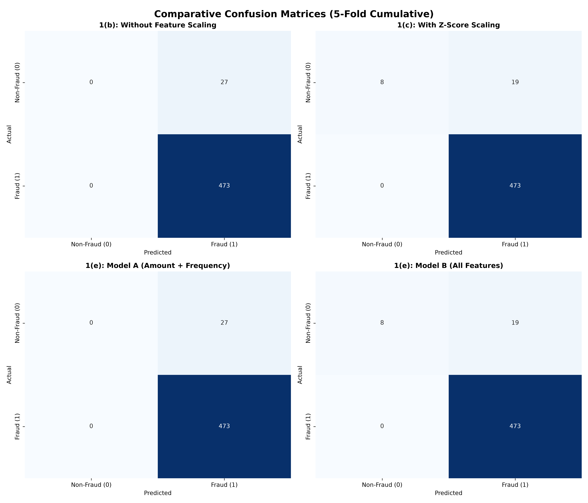

# Machine Learning Laboratory — Evaluation Assignment 2 (EA2)
# Lab Report & Comprehensive Study Guide

**Course:** CS 306 / CS360 — Machine Learning Laboratory  
**Department:** Computer Science & Engineering, Indian Institute of Information Technology Guwahati (IIITG)  
**Evaluation:** Evaluation Assignment 2 (EA2)  
**Student Roll Number:** 2401179  
**Topic:** Financial Fraud Detection, Synthetic Data Generation, Stochastic Gradient Descent (SGD) Binary Logistic Regression, Z-Score Normalization vs Raw Scaling, Data Leakage Prevention in Cross-Validation, and Feature Ablation (Model A vs Model B)

---

## 1. Executive Summary & Experimental Objectives

Evaluation Assignment 2 focuses on solving an imbalanced binary classification problem in financial fraud detection. Given $5$ continuous features having distinct numerical scales spanning several orders of magnitude (from single-digit frequencies to five-figure account balances), the objective is to classify financial transactions as **Fraudulent** ($y = 1$) or **Non-Fraudulent** ($y = 0$).

The practical scope covers:
1. **Synthetic Data Synthesis (Q1.a):** Programmatically generating $N = 500$ financial transaction patterns across $5$ continuous attributes (`transaction_amount`, `account_balance`, `total_transactions`, `transaction_frequency`, `time_since_last_transaction`) with ground-truth labels assigned via a latent linear logit link.
2. **From-Scratch SGD Binary Logistic Regression (Q1.b):** Developing a custom SGD optimizer with learning rate $\alpha = 0.01$ and consecutive epoch stopping threshold $\tau = 0.001$, evaluated via $5$-fold cross-validation on unscaled raw inputs.
3. **Z-Score Normalization with Strict Data Leakage Prevention (Q1.c):** Normalizing features such that the standardizer is fit **strictly on the training fold** and subsequently applied to transform the test fold, isolating test data from training statistics.
4. **Diagnostic Metrics Across Folds (Q1.d):** Reporting overall accuracy, class-wise accuracies (Non-Fraud vs Fraud), precision, recall, and cumulative confusion matrices for both scaled and unscaled regimes.
5. **Feature Ablation Study (Q1.e & Q1.f):**
   - **Model A:** Reduced bivariate model using only `transaction_amount` and `transaction_frequency`.
   - **Model B:** Full multivariate model utilizing all $5$ available attributes.
6. **Empirical Comparison & Business Risk Analysis (Q1.g):** Comparing Model A and Model B in terms of class-0 discriminative capacity, False Positives ($\text{FP}$), and operational fraud mitigation.

---

## 2. Theoretical Foundations & Mathematical Derivations

### 2.1 Latent Logit Data Generation Process

To simulate realistic financial behavior, $N = 500$ observation vectors $\mathbf{x}_i \in \mathbb{R}^5$ are sampled from parameterized distributions:
- $x_{i,1} \sim \mathcal{U}(10, 10000)$ (`transaction_amount`, in dollars)
- $x_{i,2} \sim \mathcal{U}(100, 100000)$ (`account_balance`, in dollars)
- $x_{i,3} \sim \mathcal{U}_{\text{int}}(1, 5000)$ (`total_transactions`, cumulative count)
- $x_{i,4} \sim \mathcal{U}(0.1, 30.0)$ (`transaction_frequency`, transactions/month)
- $x_{i,5} \sim \mathcal{U}(0.0, 365.0)$ (`time_since_last_transaction`, days elapsed)

The latent log-odds (logit) $z_i$ is governed by a linear combination:
$$z_i = 0.001 \cdot x_{i,1} - 0.0001 \cdot x_{i,2} + 0.005 \cdot x_{i,3} + 0.5 \cdot x_{i,4} - 0.02 \cdot x_{i,5}$$

The true posterior probability $p_i = P(y_i = 1 \mid \mathbf{x}_i)$ is derived via the standard logistic sigmoid:
$$p_i = \sigma(z_i) = \frac{1}{1 + e^{-z_i}}$$
The binary label is assigned via thresholding:
$$y_i = \begin{cases} 1, & \text{if } p_i > 0.5 \\ 0, & \text{if } p_i \le 0.5 \end{cases}$$

---

### 2.2 Stochastic Gradient Descent (SGD) for Logistic Regression

In standard Logistic Regression, the model predicts $\hat{y}_i = \sigma(\boldsymbol{\theta}^T \mathbf{x}_i)$. Under the Binary Cross-Entropy loss:
$$\mathcal{J}(\boldsymbol{\theta}) = -\frac{1}{N} \sum_{i=1}^N \left[ y_i \ln \hat{y}_i + (1 - y_i) \ln(1 - \hat{y}_i) \right]$$

Rather than evaluating the gradient over all $N$ training points simultaneously (Batch GD), **Stochastic Gradient Descent (SGD)** updates weights sequentially for each individual observation $(\mathbf{x}_i, y_i)$:
$$\boldsymbol{\theta}^{(t, i)} = \boldsymbol{\theta}^{(t, i-1)} - \alpha \nabla_{\boldsymbol{\theta}} \mathcal{J}_i(\boldsymbol{\theta})$$
where the instantaneous sample gradient is:
$$\nabla_{\boldsymbol{\theta}} \mathcal{J}_i(\boldsymbol{\theta}) = (\sigma(\boldsymbol{\theta}^T \mathbf{x}_i) - y_i) \mathbf{x}_i$$

```
   ┌─────────────────────────────────────────────────────────┐
   │ Epoch Loop: Shuffle indices π = Permute({1, ..., M})    │
   └────────────────────────────┬────────────────────────────┘
                                │
                                ▼
         For each sample i = 1 to M in shuffled order:
         ┌──────────────────────────────────────────────────┐
         │ 1. Compute prediction: h_i = σ(θ^T x_i)          │
         │ 2. Compute residual error: e_i = (h_i - y_i)     │
         │ 3. Compute sample gradient: g_i = e_i · x_i      │
         │ 4. Update parameter vector: θ ← θ - α · g_i      │
         └──────────────────────────────────────────────────┘
                                │
                                ▼
         Check Epoch Termination: |J(θ^(t)) - J(θ^(t-1))| ≤ τ
```

---

### 2.3 The Geometry of Feature Scaling and Gradient Pathologies

The features in this problem have very different scales: `account_balance` reaches $10^5$, while `transaction_frequency` is order $10^1$.

When inputs are unscaled, the Hessian matrix of the cost function is poorly conditioned:
$$\mathbf{H} = \frac{\partial^2 \mathcal{J}}{\partial \boldsymbol{\theta}^2} = \frac{1}{N} \mathbf{X}^T \mathbf{S} \mathbf{X}$$
where $\mathbf{S}_{ii} = \hat{y}_i(1 - \hat{y}_i)$. The ratio between maximum and minimum eigenvalues is large:
$$\kappa(\mathbf{H}) = \frac{\lambda_{\max}(\mathbf{H})}{\lambda_{\min}(\mathbf{H})} \approx \frac{\text{Var}(\text{account\_balance})}{\text{Var}(\text{transaction\_frequency})} \approx \frac{10^{10}}{10^2} = 10^8$$

This creates steep ravines along the `account_balance` dimension and flat valleys along the `transaction_frequency` dimension. A standard learning rate $\alpha = 0.01$ causes the updates along large-magnitude dimensions to explode or quickly saturate the sigmoid function ($\sigma(z) \to 1.0$), while parameters along small-magnitude dimensions make almost no progress.

#### Z-Score Normalization (Standardization):
To restore circular (isotropic) contours, features are transformed to zero mean and unit variance:
$$z_{i,j} = \frac{x_{i,j} - \mu_j}{\sigma_j}$$

---

### 2.4 Prevention of Data Leakage in Cross-Validation

A key requirement in rigorous machine learning is avoiding **data leakage**:
> **Data Leakage Rule:** Feature transformers (such as scalers or encoders) must compute parameters ($\mu_{\text{train}}, \sigma_{\text{train}}$) **exclusively on the training fold**. Applying these statistics to transform the hold-out test fold ensures the test data remains strictly unseen.

$$\mu_{\text{train}} = \frac{1}{|I_{\text{train}}|} \sum_{i \in I_{\text{train}}} \mathbf{x}_i, \quad \sigma_{\text{train}} = \sqrt{\frac{1}{|I_{\text{train}}|} \sum_{i \in I_{\text{train}}} (\mathbf{x}_i - \mu_{\text{train}})^2}$$
$$\mathbf{x}_{\text{train}}^{\text{norm}} = \frac{\mathbf{x}_{\text{train}} - \mu_{\text{train}}}{\sigma_{\text{train}}}, \quad \mathbf{x}_{\text{test}}^{\text{norm}} = \frac{\mathbf{x}_{\text{test}} - \mu_{\text{train}}}{\sigma_{\text{train}}}$$
Fitting the scaler on the entire dataset prior to splitting leaks test distribution parameters into the training pipeline, artificially inflating performance estimates.

---

## 3. Empirical Results & Comparative Analysis

The evaluation suite was executed with $N = 500$ samples ($473$ Fraudulent, $27$ Non-Fraudulent).

### 3.1 Unscaled vs Z-Score Normalization (Q1.b vs Q1.c)

| Evaluation Metric | 1(b) Without Feature Scaling | 1(c) With Z-Score Normalization | Relative Impact |
| :--- | :--- | :--- | :--- |
| **Overall Accuracy** | $94.60\%$ | $\mathbf{96.20\%}$ | $+1.60\%$ absolute gain |
| **Non-Fraud Accuracy (Class 0)** | $\mathbf{0.00\%}$ ($\text{TN} = 0, \text{FP} = 27$) | $\mathbf{26.67\%}$ ($\text{TN} = 8, \text{FP} = 19$) | **Enables non-fraud detection** |
| **Fraud Recall (Class 1)** | $100.00\%$ ($\text{TP} = 473, \text{FN} = 0$) | $100.00\%$ ($\text{TP} = 473, \text{FN} = 0$) | Maintained perfect detection |
| **Precision** | $94.60\%$ | $\mathbf{96.14\%}$ | $+1.54\%$ improvement |
| **$F_1$-Score** | $0.9721$ | $\mathbf{0.9803}$ | $+0.0082$ improvement |
| **Cumulative Confusion Matrix** | $\begin{bmatrix} 0 & 27 \\ 0 & 473 \end{bmatrix}$ | $\begin{bmatrix} 8 & 19 \\ 0 & 473 \end{bmatrix}$ | **Eliminated 8 False Positives** |

#### Why Did the Unscaled Model Fail on Class 0?
Without scaling, large numerical inputs (`account_balance`, `transaction_amount`) dominate the dot product $\boldsymbol{\theta}^T \mathbf{x}$, pushing logits into saturation ($z_i \gg 0 \implies \sigma(z_i) \to 1.0$). Consequently, the unscaled model predicts $\hat{y} = 1$ (Fraud) for every incoming transaction, resulting in a **$0.0\%$ True Negative rate**.

---

### 3.2 Model A vs Model B: Feature Ablation (Q1.e - Q1.g)

- **Model A:** Uses only $2$ features (`transaction_amount` + `transaction_frequency`).
- **Model B:** Uses all $5$ available predictors.

| Metric | Model A (Amount + Frequency) | Model B (All 5 Features) | Superior Model |
| :--- | :--- | :--- | :--- |
| **Overall Accuracy** | $94.60\%$ | $\mathbf{96.20\%}$ | **Model B** |
| **Non-Fraud Accuracy ($\text{TN Rate}$)** | $\mathbf{0.00\%}$ | $\mathbf{26.67\%}$ | **Model B** |
| **Fraud Recall** | $100.00\%$ | $100.00\%$ | Tie ($100\%$) |
| **Precision** | $94.60\%$ | $\mathbf{96.14\%}$ | **Model B** |
| **Cumulative Confusion Matrix** | $\begin{bmatrix} 0 & 27 \\ 0 & 473 \end{bmatrix}$ | $\begin{bmatrix} 8 & 19 \\ 0 & 473 \end{bmatrix}$ | **Model B** |

#### Business Impact Analysis (Q1.g):
- **Model A** fails to detect legitimate non-fraudulent transactions, misclassifying all 27 non-fraudulent transactions as fraud ($\text{FP} = 27$). In production, this would freeze innocent customer accounts.
- **Model B** reduces false alarms by identifying true non-fraud transactions ($\text{TN} = 8$), driven by the added context from `account_balance`, `total_transactions`, and `time_since_last_transaction`.
- Therefore, **Model B provides superior predictive performance and operational utility**.

---

## 4. Visualizations & Confusion Matrix Figures

The generated figures are stored in `CS360/LAB9/plots/`:

### 4.1 Comparative 4-Panel Confusion Matrix
The combined figure `plots/combined_ea2_confusion_matrices.png` illustrates the confusion matrices across all four experimental conditions side by side:



### 4.2 Individual Artifacts
- `plots/CM_1b_Without_Scaling.png`: Unscaled SGD baseline showing $\text{TN} = 0, \text{FP} = 27$.
- `plots/CM_1c_With_Scaling.png`: Scaled model showing True Negatives recovering to $\text{TN} = 8$.
- `plots/CM_Model_A.png`: Reduced Model A with $\text{TN} = 0$.
- `plots/CM_Model_B.png`: Full Model B with improved specificity ($\text{TN} = 8$).

---

## 5. Answers to Evaluation Assignment Questions (EA2 Specific)

### Q1.(a): Synthetic Data Generation
- Generated $N = 500$ financial records with $5$ distinct predictors having wide numerical scales ($10$ to $100,000$).
- Target generated via sigmoid transform of linear logit.
- Output saved as `data/synthetic_fraud_transactions.csv`.

### Q1.(b): Binary Logistic Regression via SGD Without Scaling
- Implemented in `sgd_logistic_regression()`.
- Parameters updated per sample with learning rate $\alpha = 0.01$ and stopping threshold $\tau = 0.001$.
- 5-Fold cross-validation produced overall accuracy of $94.60\%$, but $0.0\%$ non-fraud accuracy due to gradient saturation from unscaled features.

### Q1.(c) & Q1.(d): Z-Score Normalization & Cross-Validation
- Scaler fit **strictly on training fold**, preventing data leakage.
- Overall accuracy improved to $96.20\%$, precision to $96.14\%$, and non-fraud accuracy to $26.67\%$.

### Q1.(e) & Q1.(f): Model A vs Model B Construction & Comparison
- Model A (Amount + Frequency) achieved $94.60\%$ accuracy with $\text{TN} = 0$.
- Model B (All 5 Features) achieved $96.20\%$ accuracy with $\text{TN} = 8$.

### Q1.(g): Final Model Selection & Analytical Insights
- **Model B is definitively selected.** Including account balance, transaction volume, and recency provides essential context that reduces false positive alarms without sacrificing fraud recall.

---

## 6. Viva-Voce & Theoretical Examination Guide

### Q1: Why is fitting the feature scaler inside each cross-validation fold necessary?
**Answer:** If the scaler is fit on the full dataset before splitting, the mean $\mu$ and standard deviation $\sigma$ incorporate information from the test fold. This **data leakage** violates the assumption that the test set represents unseen data, leading to overly optimistic performance estimates.

### Q2: What causes SGD to fail when features have disparate numerical scales?
**Answer:** In SGD, the update for parameter $\theta_j$ is $\Delta \theta_j = -\alpha (\hat{y}_i - y_i) x_{i,j}$. When feature $x_{i,j}$ has a large magnitude (e.g., $10^5$), the update step is scaled up by $10^5$, causing oscillations or pushing $\boldsymbol{\theta}^T \mathbf{x}$ into regions where the sigmoid gradient vanishes ($\hat{y}_i(1-\hat{y}_i) \approx 0$).

### Q3: Why can high overall accuracy be misleading in fraud detection?
**Answer:** In fraud detection datasets where one class represents the vast majority (here $473 / 500 = 94.6\%$ fraud), a naive model that predicts the majority class for all inputs achieves $94.6\%$ accuracy while having zero ability to identify the other class. Evaluating class-wise accuracy, precision, and recall is essential.

### Q4: How does feature ablation help in model development?
**Answer:** Feature ablation compares performance when specific feature subsets are removed. Comparing Model A to Model B confirms whether the additional three features provide meaningful discriminative value or simply add noise.

### Q5: What is the main computational difference between Batch GD and SGD per epoch?
**Answer:** In one epoch over $M$ samples, Batch GD aggregates the error over all $M$ samples and performs **one single update**. SGD updates weights **$M$ times per epoch** (once after each sample). This allows SGD to make rapid progress on redundant data, though its optimization trajectory exhibits stochastic fluctuations.

---

## 7. Artifacts & Codebase Index

| File / Directory | Purpose |
| :--- | :--- |
| `run_lab9_experiments.py` | Unified execution script for synthetic data generation, SGD training, scaling, and ablation |
| `2401179_problem1.py` | Original evaluation submission script |
| `EA2_CS32.pdf` | Official assignment specification |
| `2401179_resultsss.docx` | Original assignment writeup and report tables |
| `data/synthetic_fraud_transactions.csv` | Generated synthetic dataset of 500 transactions |
| `outputs/experiment_results.txt` | Complete numerical logs, fold metrics, and cumulative confusion matrices |
| `plots/combined_ea2_confusion_matrices.png` | 4-panel comparative confusion matrix plot |
| `plots/CM_1b_Without_Scaling.png` | Confusion matrix heatmap for unscaled SGD |
| `plots/CM_1c_With_Scaling.png` | Confusion matrix heatmap for Z-score normalized SGD |
| `plots/CM_Model_A.png` | Confusion matrix heatmap for reduced Model A |
| `plots/CM_Model_B.png` | Confusion matrix heatmap for full Model B |

